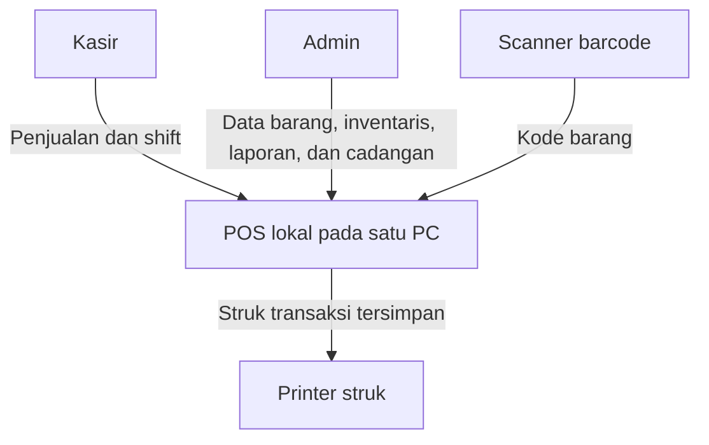
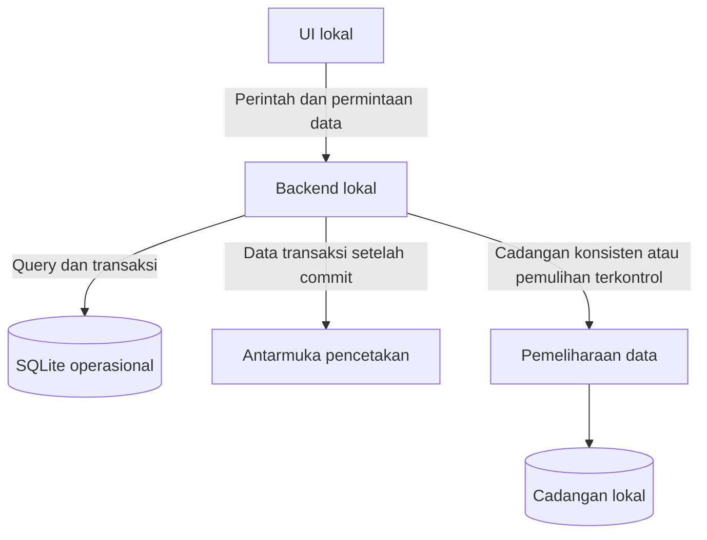
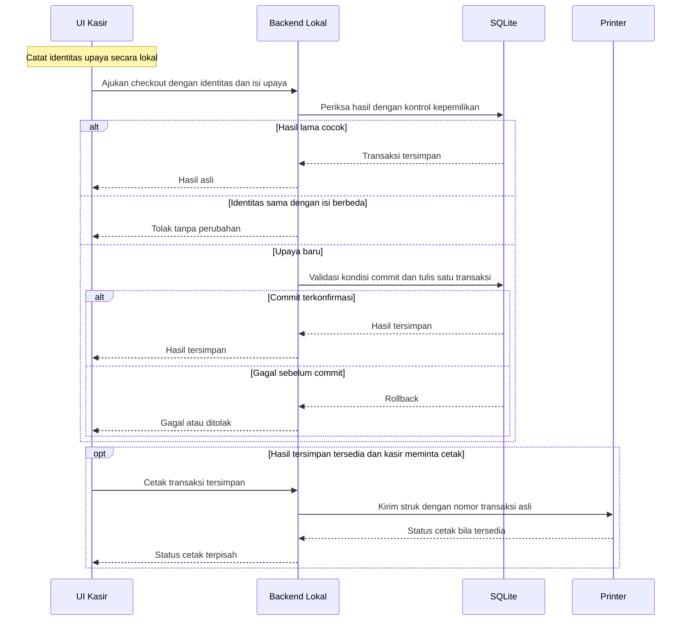
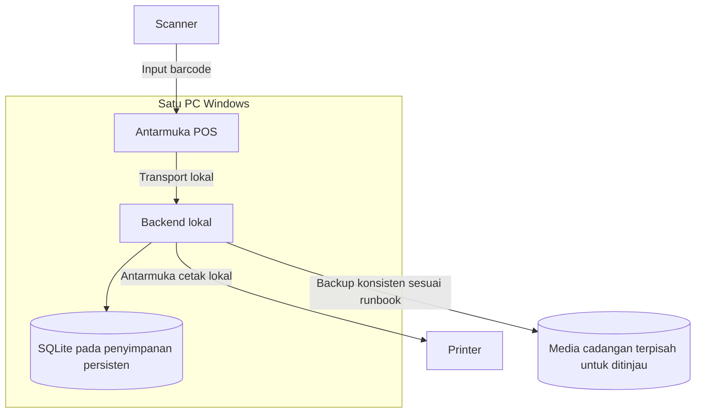

# Arsitektur Sistem Kasir dan Inventaris Minimarket Kampus

## 1. Document Control

| Atribut | Isi |
| --- | --- |
| Lokasi | `docs/architecture/ARCHITECTURE.md` |
| Versi | 0.2.1 — 11 November 2026 |
| Status | BASELINE DESAIN UNTUK REVIEW TEKNIS; belum dibuktikan pada PC kasir |
| Koordinasi review | David, bersama Syafroni, Rahmat, dan Naazmi |
| Sumber | [CONTEXT.md](../../CONTEXT.md) v0.1.0, [PRD.md](../product/PRD.md) v0.3.1, [DECISIONS.md](../product/DECISIONS.md) v0.2.3, [SCOPE.md](../product/SCOPE.md) v0.1.1, dan [AGENTS.md](../../AGENTS.md) |

PRD §5 menentukan perilaku dan bukti uji. DECISIONS menentukan status dan batas keputusan. Rancangan teknis dalam dokumen ini dipakai sebagai bahan review. Label `PROPOSED` dan `PENDING` mengikuti register sumber atau menandai usulan baru yang belum memiliki ID keputusan.

## 2. Architecture Goals and Constraints

- Satu aplikasi, satu PC kasir, dan dua role awal, `ADMIN` dan `CASHIER` (DEC-001/002). Dua shift dalam notulen menjadi skenario operasi berurutan di PC yang sama.
- Login lokal, penjualan, stok, shift, struk, dan laporan inti dapat dipakai saat internet terputus sebelum aplikasi dibuka (DEC-003, PRD §7).
- SQLite lokal adalah sumber data operasional (DEC-004). Penjualan dan perubahan stok harus atomik, serta retry tidak boleh menggandakan transaksi (DEC-007).
- Target distribusi desktop Windows dengan installer `.exe` dan target biaya perangkat lunak Rp0 (DEC-005/008). Biaya perangkat, UPS, media backup, dan operasional berada di luar target tersebut.
- Batasi MVP pada topologi satu PC. Akses admin jarak jauh, sinkronisasi, e-wallet, dan kiosk menunggu keputusan terkait. MVP memakai CASH dan QRIS_MANUAL sebagai keputusan tim (DEC-016); setoran, selisih, identitas merchant, dan rincian SOP shift harus divalidasi pengelola sebelum cutover. Stok negatif diblokir dan koreksi dicatat oleh ADMIN menurut baseline SCOPE, sambil menunggu validasi operasional.

## 3. System Context

Kasir dan admin memakai aplikasi di PC yang sama sesuai role dan SOP yang akan disahkan. Scanner menyediakan input barcode. Printer menerima hasil cetak dari transaksi tersimpan. Pengelola memvalidasi prosedur dan uji terima. Kebutuhan akun supervisor masih `PENDING` (DEC-019).

## 4. Architecture Overview

Gunakan UI lokal, backend lokal, dan SQLite dengan batas yang jelas. Backend menjadi satu pintu untuk akses data dan perubahan operasional. Pemisahan komponen bersifat logis. Pilihan proses dan cara aplikasi memulai komponen mengikuti review packaging. Pembagian modul Kasir dan Admin/Inventaris mengikuti baseline DEC-009.

React, Vite, TypeScript, Node.js, dan Express merupakan baseline `PROPOSED` (DEC-010). Diagram menggambarkan tanggung jawab yang diperlukan untuk MVP terlepas dari framework dan wrapper.

## 5. Component Responsibilities

| Komponen | Tanggung jawab | Fokus review |
| --- | --- | --- |
| UI lokal | Navigasi sesuai role, scan/cari produk, keranjang, konfirmasi total, status checkout dan cetak, serta layar pemulihan. Simpan identitas upaya sebelum pengajuan melalui mekanisme lokal yang direview. | Syafroni |
| Backend lokal | Autentikasi, izin per operasi, kepemilikan, harga dan stok saat commit, checkout, shift, penerimaan barang, laporan, dan audit. | Rahmat, David |
| SQLite | Persistensi akun, master barang, shift, penjualan, item, pembayaran, saldo dan mutasi, hasil upaya, serta audit. Tegakkan invariant data melalui transaksi dan constraint yang dirancang. | David, Rahmat |
| Antarmuka perangkat | Terima input scanner dan jalankan pencetakan dari data tersimpan. Kembalikan status perangkat terpisah dari transaksi. | Syafroni, Rahmat, Naazmi |
| Pemeliharaan data | Buat cadangan konsisten, validasi restore di lingkungan terpisah, dan kendalikan akses operasional saat pemulihan. | Rahmat, Naazmi, David |

## 6. Frontend and Backend Communication

Baseline `PROPOSED` untuk DEC-010 adalah API HTTP lokal pada loopback. Jika wrapper yang dipilih mendukung IPC, bandingkan dengan antarmuka IPC terbatas. Keduanya wajib menegakkan aturan backend yang sama. Simpan rute, bentuk payload, autentikasi transport, dan kode error dalam kontrak yang direview. Pembagian alur di bawah berlaku pada kedua opsi.

| Operasi logis | Masukan atau keluaran penting |
| --- | --- |
| Login dan akses | Kredensial lokal, status sesi dan role. Backend mengambil identitas dari sesi yang valid. |
| Checkout | Identitas upaya, shift, produk dan kuantitas, harga/total yang disetujui, serta data pembayaran sesuai kebijakan. Backend menghitung ulang dan mengembalikan hasil commit atau alasan penolakan. |
| Periksa hasil upaya | Identitas upaya dan sesi yang sah. Bedakan hasil tersimpan, belum tersimpan yang telah dipastikan, dan status yang masih belum jelas. |
| Shift dan struk | Ringkasan berdasarkan transaksi tersimpan, hasil penutupan, serta permintaan cetak ulang dengan rujukan transaksi yang sama. |

Timeout, koneksi UI ke backend terputus, atau respons yang hilang harus ditampilkan sebagai hasil belum diketahui sampai status diperiksa. Untuk checkout yang ditolak secara definitif dan kemudian diubah, gunakan identitas upaya baru.

## 7. Local Database Architecture

`DATABASE.md` perlu menurunkan batas berikut ke skema, constraint, indeks, migrasi, dan uji. Nama tabel, driver SQLite, pengaturan journal/durability, dan metode transaksi penulisan masih perlu review.

| Area data | Kontrak integritas |
| --- | --- |
| Master dan riwayat | Barcode scan menunjuk satu produk aktif. Perubahan harga berlaku untuk penjualan berikutnya. Item penjualan menyimpan harga saat transaksi. |
| Penjualan dan stok | Satu commit untuk penjualan, item, data pembayaran, hasil upaya dan mutasi stok. Jika saldo dipersistenkan, perbarui saldo di commit yang sama. Mutasi merujuk dokumen sumber. |
| Penerimaan barang | Catatan penerimaan dan mutasi tersimpan bersama. Identitas upaya yang sama tidak boleh mencatat penerimaan dua kali. |
| Identitas upaya | Cegah duplikasi pada batas persistensi, termasuk pengajuan paralel. Baseline DEC-013 memerlukan pembandingan isi upaya dan pemeriksaan kepemilikan sebelum hasil lama diberikan. |
| Shift | Shift tersimpan terpisah dari sesi. Baseline DEC-012 memerlukan maksimum satu shift aktif per stasiun dan urutan commit yang konsisten antara checkout dan penutupan. |
| Laporan dan audit | Laporan membaca data tersimpan. Audit menyimpan pelaku dan waktu untuk aksi kritis. Batas tanggal mengikuti zona operasional yang disepakati. |

Usulan implementasi checkout mencakup pemeriksaan hasil, validasi, dan penulisan dalam satu batas transaksi atau pemeriksaan ulang sesudah benturan constraint. Hasil upaya baru dianggap tersimpan setelah commit terkonfirmasi.

Gunakan migrasi yang direview dan diuji terhadap data versi sebelumnya di lingkungan development. Usulan penyimpanan Windows adalah direktori data persisten terpisah dari folder instalasi. Rancangan lokasi dan ACL perlu mempertimbangkan akun Windows yang akan menjalankan aplikasi dan pemeliharaan.

## 8. Checkout Transaction Flow

1. UI mencatat identitas upaya secara lokal sebelum mengirim checkout. Simpan konteks minimum yang dibutuhkan untuk pemeriksaan ulang setelah restart.
2. Backend memeriksa sesi, role, kepemilikan, dan hasil dengan identitas yang sama sebelum menerapkan aturan checkout baru. Isi identik menerima hasil lama walaupun shift sudah ditutup. Isi berbeda dengan identitas sama ditolak. Gunakan jaminan unik pada penyimpanan dan selesaikan persaingan permintaan lewat transaksi.
3. Untuk upaya baru, backend memvalidasi shift aktif, keranjang, harga yang disetujui, metode bayar dan kebijakan stok dalam jalur commit. Jika harga berubah, minta konfirmasi total baru. Jika penyimpanan gagal sebelum commit, rollback seluruh perubahan.
4. Setelah commit terkonfirmasi, UI dapat memicu cetak dari data transaksi tersimpan. Jika hasil commit tidak diketahui, periksa status upaya dan bukti pembayaran fisik sebelum mencoba kembali. Pembayaran fisik, commit, dan cetak memiliki status masing-masing.

Jalur cetak pada diagram adalah alur logis. Adapter backend atau bridge lokal yang disetujui dapat memanggil layanan cetak Windows. Permintaan status setelah respons hilang memakai identitas yang sama. Bila transaksi terbukti belum tersimpan, kelanjutan checkout tetap mengikuti pemeriksaan pembayaran fisik dan SOP pilot.

## 9. Shift Lifecycle and Recovery

| Peristiwa | Perilaku |
| --- | --- |
| Buka shift | Baseline DEC-012 mencatat identitas kasir dan waktu mulai. Dua permintaan paralel hanya menghasilkan satu shift aktif. Modal awal mengikuti SOP. |
| Tutup jendela, logout, restart, listrik mati | Shift yang telah tersimpan tetap aktif dengan ID dan waktu mulai yang sama (DEC-006). Setelah login kembali, kasir pemilik dapat melanjutkan sesuai baseline PRD. |
| Tutup shift | Aksi eksplisit oleh pemilik shift, dengan data valid dan ringkasan akhir dalam commit penutupan. Jika checkout commit dahulu, masukkan transaksi ke rekap akhir. Jika penutupan commit dahulu, tolak checkout baru. |
| Gagal tutup atau respons hilang | Gagal sebelum commit mempertahankan shift aktif. Retry penutupan identik sesudah commit mengembalikan hasil asli. |
| Pemilik shift tidak tersedia | Eskalasi ke pengelola. Mekanisme pengambilalihan dan kewenangan supervisor menunggu DEC-019. |

Saat aplikasi dibuka kembali, backend membaca keadaan dari SQLite. UI menampilkan shift yang dapat diakses oleh sesi saat ini dan memeriksa upaya checkout yang belum selesai. Klasifikasi metode bayar CASH dan QRIS_MANUAL mengikuti DEC-016. Penutupan shift normal hanya boleh dilakukan pemilik shift yang sedang login; ADMIN tidak dapat menutup shift orang lain melalui endpoint normal (prosedur pemulihan admin menunggu SOP). Formula setoran dan selisih adalah baseline sementara yang wajib divalidasi.

## 10. Hardware Integration (Barcode Scanner and Receipt Printer)

| Perangkat | Opsi dan rekomendasi untuk review | Pembuktian |
| --- | --- | --- |
| Scanner | `PROPOSED` uji mode input keyboard terlebih dahulu bila didukung scanner. Input manual tetap tersedia. Integrasi driver/SDK khusus perlu alasan kompatibilitas dan tinjauan biaya. | Scan produk aktif, barcode tak dikenal, fokus input, input berulang, dan pencarian manual di PC tujuan. |
| Printer | `PROPOSED` uji antrean cetak Windows dengan driver yang tersedia. Jika butuh adapter khusus, bandingkan kebutuhan format, status perangkat, dan distribusi driver. | Uji ukuran struk, karakter, printer mati, respons cetak tidak jelas, serta cetak ulang dengan nomor yang sama. |

Status diterima antrean cetak tidak membuktikan kertas keluar. Tampilkan status sesuai informasi yang tersedia. Kegagalan cetak mempertahankan penjualan, pembayaran, dan stok yang sudah tersimpan.

## 11. Offline Operation and Failure Handling

| Kondisi | Respons sistem | Bukti uji |
| --- | --- | --- |
| Internet terputus sebelum startup | Jalankan login dan seluruh alur inti dari aset, backend, dan data lokal. | Uji alur lengkap tanpa koneksi sesuai PRD §7. |
| Listrik mati sebelum commit | Setelah startup, periksa keadaan tersimpan. Checkout yang belum commit tidak meninggalkan transaksi atau mutasi parsial. | Interupsi proses dan periksa penjualan, item, pembayaran, stok serta shift. |
| Listrik mati setelah commit atau respons hilang | Pulihkan hasil lewat identitas upaya. Jika pembayaran fisik belum jelas, periksa bukti sebelum mengulang. | Uji interupsi sesudah commit dengan satu transaksi dan satu hasil mutasi. |
| SQLite sibuk, disk penuh, atau I/O gagal | Kembalikan kegagalan yang terkonfirmasi atau status belum diketahui sesuai hasil pemeriksaan. Jika database tidak dapat dipakai, blokir penulisan operasional dan eskalasikan pemulihan. | Simulasikan kegagalan. Pastikan tidak ada data parsial atau database aktif yang diinisialisasi ulang otomatis. |
| Aplikasi atau backend berhenti | Saat kembali, periksa kesiapan layanan, login ulang sesuai kebijakan sesi, baca shift tersimpan dan periksa upaya tertunda. | Uji restart dengan shift aktif dan checkout sebelum serta sesudah commit. |
| Printer gagal | Simpan status cetak terpisah dan izinkan cetak ulang sesuai izin. | Cetak ulang dari transaksi lama, dengan saldo stok dan pembayaran tetap sama. |

## 12. Windows Desktop Packaging Strategy

DEC-005 menerima target desktop Windows dengan installer `.exe`. DEC-011 masih `PROPOSED` untuk wrapper. Pertahankan mode development lokal dan lakukan uji paket sebelum mengunci wrapper.

| Opsi | Trade-off |
| --- | --- |
| Electron | Dapat diuji dengan baseline UI web. Perlu mengukur RAM, disk, startup, integrasi perangkat, dan biaya pemeliharaan. Isolasi renderer serta batasi bridge jika dipilih. |
| Wrapper Windows alternatif | Berpotensi mengurangi ukuran paket atau jejak runtime. Periksa prasyarat Windows, distribusi offline, integrasi SQLite dan printer, serta beban belajar tim. |

Rekomendasi review adalah melakukan spike terbatas di PC tujuan dengan installer, startup offline, login, scan, checkout, cetak, restart, dan pembaruan yang mempertahankan database serta konfigurasi. Bila pembaruan gagal, uji jalur pemulihan pada instalasi uji. Fullscreen mengatur tampilan aplikasi. Kiosk Windows memerlukan keputusan dan konfigurasi tingkat OS tersendiri (DEC-019).

## 13. Security Boundaries

- Backend adalah batas otorisasi. Periksa akun aktif, sesi, role, aksi, kepemilikan shift/transaksi, dan prasyarat operasi pada setiap permintaan yang relevan. Menu UI mengikuti role. Matriks PRD §2.1 adalah baseline DEC-014 dan menjadi masukan `AUTHORIZATION.md`.
- Jika memakai HTTP, batasi layanan ke loopback dan tinjau cara mencegah origin atau proses lokal yang tak berwenang memanggil API. Jika memakai IPC, ekspos operasi terbatas dan validasi pengirim serta input. Gunakan hash kata sandi, kueri terparameterisasi, dan audit aksi kritis sesuai PRD §7.
- Pisahkan izin akun Windows dan role aplikasi. Batasi akses file SQLite, direktori cadangan, log, serta konfigurasi pada akun OS berwenang. Role aplikasi melindungi akses melalui aplikasi. Akses langsung ke file dikendalikan oleh OS dan prosedur operasional.
- Jauhkan password plaintext dan secrets dari repo, frontend, log, serta installer. Gunakan data sintetis dan database terpisah untuk development maupun QA.

## 14. Backup and Recovery Architecture

| Operasi | Rancangan untuk review |
| --- | --- |
| Backup lokal | DEC-015 adalah baseline `PROPOSED`. Buat snapshot SQLite yang konsisten dengan mekanisme backup SQLite yang kompatibel dengan driver atau salinan saat database telah ditutup secara terkendali. Hindari penyalinan file aktif secara mentah. Laporkan hasil, waktu dan titik cadangan. Pertahankan cadangan baik sebelumnya bila penulisan gagal. |
| Uji restore | Pulihkan cadangan di lingkungan terpisah. Verifikasi integritas dan cocokkan master produk, transaksi, saldo stok serta shift dengan titik cadangan. Tolak cadangan rusak sebelum menyentuh database operasional. |
| Restore operasional | Ikuti runbook yang disahkan. Kendalikan akses tulis selama pemulihan, amankan kondisi awal, dan validasi hasil sebelum membuka operasi kembali. Uji prosedur ini sebelum pilot. |

Lokasi cadangan terpisah dari PC, jadwal, retensi, hak akses, penanggung jawab, dan toleransi kehilangan data masih perlu disepakati. Pemulihan mengembalikan keadaan ke titik cadangan. Rekonsiliasi penjualan fisik setelah titik tersebut mengikuti prosedur minimarket.

## 15. Future Cloud Synchronization (Non-MVP)

Supabase merupakan kandidat fase lanjutan (DEC-020). Evaluasi setelah core lokal stabil dan arti real-time post dikonfirmasi. Opsi satu arah memerlukan definisi tujuan dan pemulihan. Dua arah juga memerlukan otoritas perubahan dan kebijakan konflik.

Jika fase ini disetujui, desain identitas unik, antrean persisten, retry aman, deduplikasi, dan status lokal versus terkirim. Checkout dan penutupan shift harus dapat selesai tanpa menunggu cloud. Backup menyimpan titik pemulihan, restore mengembalikan data dari titik tersebut, dan sinkronisasi memindahkan perubahan antarsistem sesuai kebijakan integrasi.

## 16. Deployment Topology

Pemasangan MVP menempatkan UI, backend, dan SQLite pada satu PC Windows. Hubungan UI dan backend bersifat lokal. Scanner dan printer memakai koneksi perangkat yang tersedia pada PC tujuan. Backup berjalan lokal, dengan media cadangan terpisah sebagai pilihan pilot yang perlu disepakati.

Topologi pilot tidak mengasumsikan server jaringan, PC admin kedua, atau layanan berbayar. Perangkat dan opsi lokasi penyimpanan dibuktikan pada uji instalasi dan pemulihan.

## 17. Architecture Trade-offs and Risks

| Risiko atau trade-off | Mitigasi dan bukti |
| --- | --- |
| Satu PC menyederhanakan distribusi, tetapi kerusakan perangkat menghentikan operasi. | Uji cadangan yang dapat dipulihkan dari media terpisah dan ukur waktu pemulihan. Validasi kebutuhan UPS. |
| Timeout, restart, atau checkout paralel dapat memicu pengulangan pembayaran. | Pisahkan hasil pembayaran fisik dari commit. Uji satu hasil per upaya, konflik payload, dan pemulihan pascarestart. |
| I/O cetak memiliki status yang kadang terbatas. | Simpan transaksi dahulu, tampilkan status cetak yang tersedia dan uji cetak ulang. |
| Aturan stok, pembayaran, dan setoran belum lengkap. | Pakai fixture PRD berlabel untuk development. Ulangi uji dengan SOP pilot yang disahkan. |
| Windows, scanner, dan printer tujuan belum terverifikasi. | Ukur startup, pencarian, checkout, cetak, dan pembaruan sebelum memilih wrapper dan target performa. |
| Pemindahan dari sistem lama dapat membawa saldo awal yang keliru. | Verifikasi ekspor, rekonsiliasi master dan saldo, uji restore, lalu sepakati jadwal cutover dan prosedur kembali. |

## 18. Open Architecture Decisions

| Status dan rujukan | Pilihan dan trade-off | Review yang diperlukan |
| --- | --- | --- |
| `PROPOSED` DEC-010/011 | HTTP loopback memudahkan development lokal. IPC membutuhkan wrapper yang mendukungnya dan pembatasan bridge. | Uji baseline lokal dan paket kandidat. Pilih transport, versi runtime, wrapper dan driver SQLite setelah bukti perangkat dan review batas akses. |
| Usulan `PROPOSED` berdasarkan DEC-004/007 (diterima) dan DEC-013 (usulan) | Identitas upaya dapat disimpan di penyimpanan UI persisten atau melalui backend sebelum pengajuan. Pilihan memengaruhi pemulihan restart dan koordinasi dengan commit. | Tentukan lokasi, constraint unik, pembandingan isi, urutan penulisan, pengaturan durability, dan migrasi. Uji retry paralel, rollback dan interupsi. |
| `PROPOSED` DEC-011/015 sebagai dasar | Direktori data per pengguna memudahkan isolasi akun OS. Direktori data bersama memerlukan izin eksplisit. Snapshot saat aplikasi berjalan mengurangi jeda. Salinan saat layanan berhenti membutuhkan jendela pemeliharaan. | Cocokkan lokasi dengan pola penggunaan akun Windows dan uji backup, ACL, restore, serta update installer. |
| `ACCEPTED` sebagian DEC-016; `PROPOSED/PENDING` DEC-017–019/021 | QRIS manual dipilih tim. SOP setoran, kebijakan stok, koreksi, supervisor, penggunaan PC, data awal dan cutover bergantung pada pengelola. | Validasi SOP, zona operasional, fixture pilot, spesifikasi perangkat dan akses yang diperlukan. |
| `PROPOSED` DEC-020 dan `PENDING` DEC-023 | Sinkronisasi satu arah dan dua arah memiliki tanggung jawab konflik berbeda. Pembayaran digital perlu validasi terpisah. | Tinjau sesudah alur inti stabil dan kebutuhan lapangan terkonfirmasi. |

## 19. Requirement and Decision Traceability

ID detail dan skenario Given–When–Then berada di PRD §5. Rentang berikut mengarahkan review ke kelompok arsitektur dan pengujian yang terdampak.

| Area | Requirement dan bukti penerimaan | Keputusan | Bagian |
| --- | --- | --- | --- |
| Akses, izin, akun dan audit | POS-01.01–04 / AC-01.01–04 | DEC-001/003/014/019 | §6, §13 |
| Master, barcode dan harga | POS-02.01–03 / AC-02.01–03 | DEC-009/014 | §7, §10 |
| Penjualan, pembayaran dan stok | POS-03.01–08 / AC-03.01–08 | DEC-003/004/007/016–018 | §7–8, §11 |
| Retry, pemulihan checkout dan struk | POS-04.01–03 / AC-04.01–03 | DEC-007/013 | §8, §10–11 |
| Shift dan setoran | POS-05.01–02, POS-06.01–03 / AC-05.01–02, AC-06.01–03 | DEC-002/006/012/016/019 | §9 |
| Penerimaan dan laporan | POS-07.01–02, POS-08.01–02 / AC-07.01–02, AC-08.01–02 | DEC-004/009/018 | §5, §7 |
| Backup, restore dan Windows | POS-09.01–02, POS-10.01–02 / AC-09.01–02, AC-10.01–02 | DEC-005/011/015/021/022 | §12, §14, §16 |
| Kandidat dan fase lanjutan | POS-PND-01–07. Kriteria uji mengikuti keputusan yang disahkan. | DEC-017–020/023 | §13, §15, §18 |

Gunakan §7–9 dan §14 untuk menurunkan invariant data, migrasi dan pemulihan ke `DATABASE.md`. Gunakan §6, §9, §13, serta matriks PRD §2.1 untuk merinci peran, kepemilikan, penolakan dan audit di `AUTHORIZATION.md`. Untuk implementasi, mulai dari alur produk → scan/cari → checkout tunai uji → stok → laporan sederhana pada satu PC, lalu uji terhadap ID POS dan AC terkait.

## 20. Addendum penyelarasan Product baseline (11 November 2026)

Bagian ini **menggantikan asumsi lama yang tidak sesuai** dengan `SCOPE.md` v0.1.1 dan `DECISIONS.md` v0.2.3. Prioritaskan aturan di sini bila ada konflik dengan uraian sebelumnya; perubahan resmi berikutnya harus diperbarui pada dokumen sumber dan ditinjau ulang.

| Aspek | Kontrak desain MVP | Pembuktian wajib |
|---|---|---|
| Pembayaran | CASH atau QRIS_MANUAL; POS tidak menghasilkan QR atau memanggil API bank | Transaksi tunai/QRIS diuji dengan verifikasi merchant nyata |
| QRIS manual | UI memerlukan konfirmasi kasir setelah pemeriksaan status berhasil dan nominal; tidak menyimpan kredensial/rahasia bank; bukti petugas/waktu tersimpan | Kegagalan pembayaran, salah nominal, internet merchant mati |
| Laporan | Rekap tunai dan QRIS tidak dicampur sebagai uang laci | Rekonsiliasi shift kasir |
| Stok | Koreksi manual hanya ADMIN, dengan alasan + audit; stok akhir tak boleh negatif | Uji koreksi naik/turun dan penjualan ditolak |
| Keamanan | Backend mengizinkan operasi per role; renderer Electron tanpa akses DB/file/Node langsung | Uji penolakan bypass frontend dan IPC |
| Perangkat | Satu PC Windows, barcode keyboard wedge kandidat; cetak hanya dari transaksi committed | Tes scanner, printer, restart/offline di PC tujuan |
| Cloud | Sinkronisasi ditunda; tidak boleh jadi syarat checkout/restore lokal | Tes tanpa akses internet |
| Cutover | Tidak boleh GO tanpa migrasi barang, SOP shift, data cadangan, dan tes pada perangkat asli | VAL-01–08 pada `SCOPE.md` |

### 20.1 Siklus checkout QRIS manual — risiko pembayaran sudah masuk tetapi commit gagal

1. Keranjang dan identitas upaya `attempt_key` disiapkan; simpan upaya lokal sebelum pembayaran diminta.
2. Kasir menunjukkan QRIS merchant eksternal. **Tidak ada pemotongan stok atau `sale` committed pada tahap ini.**
3. Kasir memeriksa status *berhasil* dan nominal transaksi pada perangkat merchant resmi. Identitas petugas dan waktu verifikasi dikirim ke backend dalam permintaan checkout.
4. Backend memvalidasi isi upaya, total, shift, stok, dan otorisasi; lalu menyimpan `sales`, `sale_items`, `payments`, `inventory_movements` dan audit verifikasi secara atomik.
5. Jika hasil commit tak jelas, cek `GET /api/v1/checkouts/{attemptKey}`. **Jangan meminta pelanggan membayar ulang.** Bila belum tersimpan tetapi pembayaran bank terkonfirmasi, butuh prosedur rekonsiliasi/manual yang disetujui pengelola (VAL-01).
6. Cetak struk setelah commit; kegagalan printer tidak membatalkan pembayaran atau menggandakan penjualan.

### 20.2 Persyaratan runtime Electron lokal

Desain kandidat: Electron main process menjalankan server backend yang hanya bind `127.0.0.1`, dengan port acak/terkontrol, token sesi, pemeriksaan `Origin` dan CSRF sesuai model lokal, serta penutupan lifecycle saat aplikasi keluar. Renderer mengaktifkan `contextIsolation`, `sandbox`, menonaktifkan `nodeIntegration`; preload hanya mengekspos API terbatas. Jangan menyimpan database di ASAR atau direktori instalasi; gunakan `app.getPath('userData')`/lokasi persisten yang tervalidasi. Detail eksekusi adalah **usulan teknis**, bukan keputusan DEC-010/011 yang telah disahkan.

### 20.3 Aturan prioritas desain dan masalah terbuka

- `DATABASE.md` harus memodelkan koreksi stok ADMIN dan verifikasi QRIS manual sebelum dianggap siap implementasi.
- Apabila REST API dipakai, kontrak error dan idempotency di `API_CONTRACT.md` berlaku sama ketika offline.
- Bila PC terlalu terbatas menjalankan Electron, review alternatif packaging bersama tim sebelum mengubah DEC-011.
- Hasil pemindaian perangkat, validasi SOP, dan tanggal lisensi tetap **PENDING** sampai ada bukti lapangan. Arsitektur ini tidak menyatakan telah diuji pada perangkat nyata.
