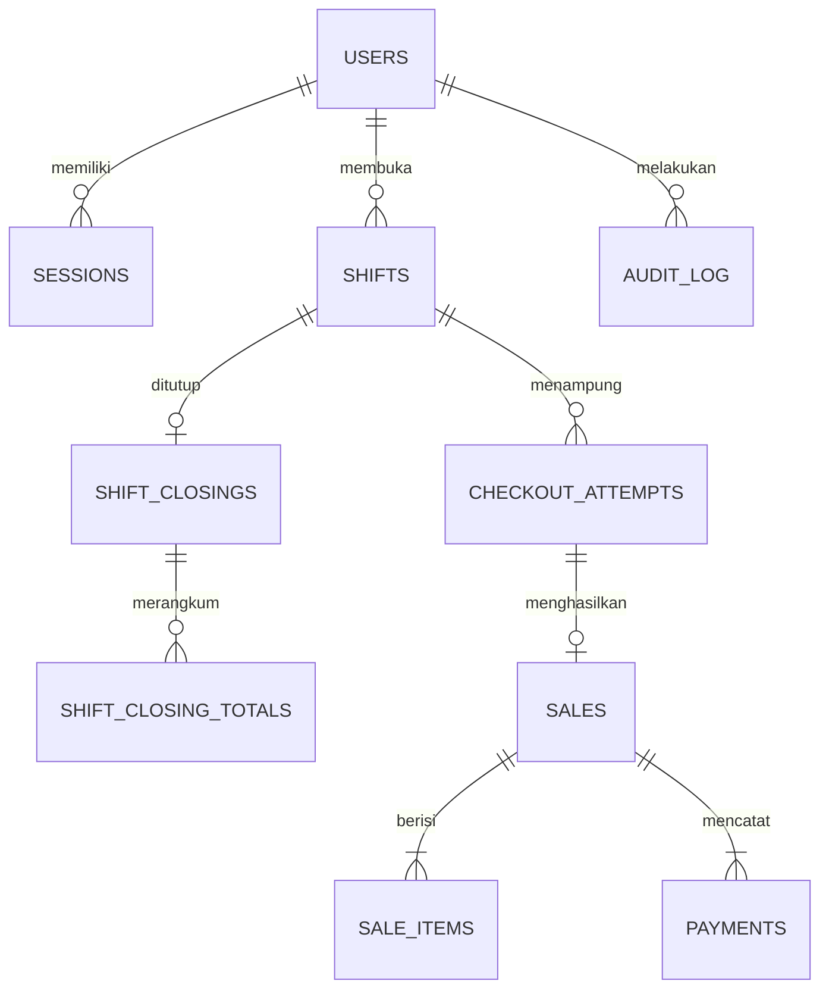
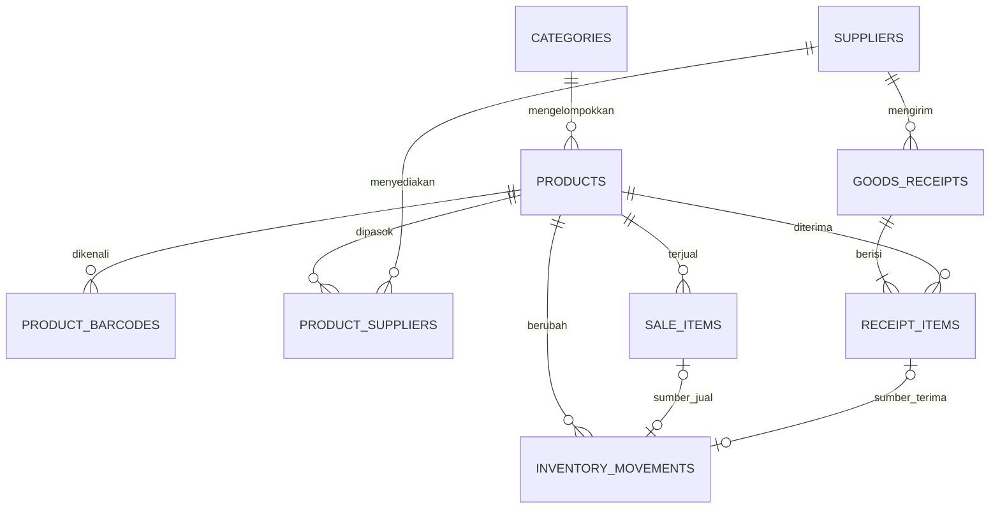

# Rancangan Database SQLite — Sistem Kasir dan Inventaris Minimarket Kampus

## 1. Document Control

| Atribut | Isi |
|---|---|
| Lokasi | `docs/architecture/DATABASE.md` |
| Versi | 0.2.1 — 11 November 2026 |
| Status | **BASELINE DESAIN UNTUK REVIEW TEKNIS**, belum siap migrasi otomatis |
| Penanggung jawab review | David untuk model data, Rahmat untuk transaksi dan driver, Syafroni untuk kontrak UI, Naazmi untuk bukti uji |
| Sumber utama | `CONTEXT.md` v0.1.0, `docs/product/PRD.md` v0.3.1, `docs/product/SCOPE.md` v0.1.1, `docs/product/DECISIONS.md` v0.2.3, `docs/product/ACCEPTANCE_CRITERIA.md` v0.1.1, `AGENTS.md` |
| Referensi tambahan | `ARCHITECTURE.md` v0.2.1; desain awal v0.1.0 dipakai hanya sebagai riwayat sumber, bukan keputusan terbaru. |

DEC-004 menetapkan SQLite lokal. DEC-006 menetapkan persistensi shift melewati gangguan aplikasi. DEC-007 menetapkan atomisitas penjualan dan stok serta pencegahan penjualan ganda. DDL, nama tabel, dan mekanisme di bawah ini merupakan usulan. Skenario P0 mengikuti PRD draft. Persetujuan kebijakan minimarket diperlukan untuk fixture pilot yang bergantung pada SOP.

## 2. Database Goals and Constraints

- Satu database operasional persisten di PC kasir. Dua shift bekerja berurutan. Seluruh transaksi inti berjalan tanpa cloud dan tanpa akses internet.
- Backend adalah pintu tulis tunggal. Autentikasi, role, kepemilikan, dan kebijakan bisnis diperiksa di backend. UI menggunakan hasil commit untuk menampilkan status penjualan.
- Simpan uang sebagai INTEGER rupiah. Hitung dengan aritmetika integer yang diperiksa sebelum bind parameter. Simpan kuantitas sebagai unit utuh dalam fixture awal. Barang timbang atau satuan pecahan memerlukan review satuan dasar.
- Gunakan INTEGER untuk timestamp UTC dalam milidetik. Filter laporan tanggal dengan rentang setengah terbuka `[awal, akhir)` yang dihitung dari zona operasional yang disahkan. Checkout dan penutupan diurutkan lewat transaksi penulis, bukan timestamp.
- Simpan file SQLite pada direktori data lokal persisten di luar folder installer. ACL Windows, driver, versi SQLite dan pengaturan durability perlu dibuktikan pada PC tujuan.

## 3. Data Model Overview

| Domain | Sumber data |
|---|---|
| Akses | `users`, `sessions` |
| Master | `categories`, `suppliers`, `products`, `product_barcodes`, `product_suppliers` |
| Shift | `shifts`, `shift_closings`, `shift_closing_totals` |
| Checkout | `checkout_attempts` untuk identitas dan pemulihan, `sales` untuk hasil commit, `sale_items`, `payments` |
| Inventaris | `goods_receipts`, `receipt_items`, `inventory_movements`, view `stock_balances` |
| Audit | `audit_log` untuk perubahan sensitif. Riwayat cetak dan metadata backup mengikuti kebutuhan operasional tanpa mengubah dokumen transaksi. |

## 4. Entity Relationship Diagram (Mermaid ERD)

### Akses, shift, dan penjualan



### Master dan inventaris



Satu mutasi memiliki tepat satu jenis sumber. Mutasi OPENING merujuk produk dan batch impor. SALE merujuk item penjualan, RECEIPT merujuk item penerimaan, ADJUSTMENT merujuk koreksi bertanda dengan alasan serta actor ADMIN. Kardinalitas wajib pada dokumen final dipenuhi oleh layanan sebelum commit. Diagram merangkum relasi domain. DDL menegakkan relasi dan constraint yang dinyatakan di §6.

## 5. Table Specifications

**Data dictionary.** I = INTEGER, T = TEXT, B = BLOB. Semua kolom wajib kecuali bertanda opsional. PK baris internal memakai INTEGER. PK eksternal berupa TEXT untuk identitas upaya. Kolom FK mengikuti tipe PK tujuan.

| Tabel | Kolom dan tipe | Makna |
|---|---|---|
| users | id I, username T, password_hash T, role T, active I, created_at_ms I | Akun lokal dan status aktif 0/1. |
| sessions | token_digest B, user_id I, expires_at_ms I, revoked_at_ms I opsional | Digest token acak. Sesi memiliki kedaluwarsa dan pencabutan terpisah dari shift. |
| categories, suppliers | id I, name T | Master katalog dan pemasok. |
| products | id I, category_id I, sku T, name T, price_rp I, active I | Identitas internal, SKU unik, harga katalog, status jual. |
| product_barcodes | barcode T, product_id I | Kode sebagai teks agar nol awal bertahan. |
| product_suppliers | product_id I, supplier_id I | Relasi katalog banyak-ke-banyak. Penerimaan mencatat supplier aktual. |
| shifts | id I, cashier_id I, opened_at_ms I, closed_at_ms I opsional, opening_cash_rp I opsional | NULL pada closed_at_ms berarti aktif. Modal disimpan bila SOP mewajibkan. |
| shift_closings | shift_id I, close_key T, request_hash B, closed_by I, declared_cash_rp I opsional, variance_rp I opsional | Hasil penutupan tunggal. Selisih bertanda. Waktu penutupan di shifts. |
| shift_closing_totals | shift_id I, method_code T, amount_rp I | Snapshot total penjualan menurut metode ketika shift ditutup. |
| checkout_attempts | attempt_key T, shift_id I, cashier_id I, request_hash B, prepared_at_ms I, abandoned_at_ms I opsional | Disimpan lokal sebelum finalisasi. Penjualan terkait menentukan hasil tersimpan. Pembatalan teknis dapat memagari upaya yang terbukti belum commit. |
| sales | id I, sale_no T, attempt_key T, committed_at_ms I, total_rp I | Header penjualan final. Shift dan kasir berasal dari upaya checkout. |
| sale_items | id I, sale_id I, product_id I, sku_snapshot T, name_snapshot T, quantity I, unit_price_rp I, line_total_rp I | Nama, SKU, harga dan total historis untuk rekap dan cetak ulang. |
| payments | id I, sale_id I, method_code T, amount_rp I, evidence_ref T opsional, verified_by I opsional, verified_at_ms I opsional | Nilai yang dialokasikan ke penjualan dan referensi bukti minimal bila disahkan. |
| goods_receipts | id I, receipt_key T, request_hash B, supplier_id I, received_by I, committed_at_ms I, supplier_ref T opsional | Bukti penerimaan final dan identitas retry. |
| receipt_items | id I, receipt_id I, product_id I, quantity I | Kuantitas aktual diterima. |
| inventory_movements | id I, product_id I, kind T, delta I, sale_item_id I opsional, receipt_item_id I opsional, opening_batch_ref T opsional, adjustment_reason T opsional, actor_id I, created_at_ms I | Ledger bertanda dengan sumber terverifikasi. |
| stock_balances | product_id I, on_hand I | View agregat ledger. Produk tanpa mutasi mempunyai saldo nol. |
| audit_log | id I, actor_id I, action T, entity_type T, entity_id T, details T opsional, created_at_ms I | Pelaku, objek, waktu, dan perubahan terpilih. |

## 6. Primary Keys, Foreign Keys and Constraints

DDL berikut adalah **PROPOSED DESIGN**. Gunakan SQLite yang mendukung tabel STRICT, tersedia sejak 3.37.0. Aktifkan dan verifikasi foreign key untuk setiap koneksi sebelum transaksi. FK di bawah memakai perilaku default NO ACTION dan tidak menghapus histori secara berantai. Penghentian akun atau produk memakai status aktif. Nama akun baseline berupa identifier ASCII yang dinormalisasi backend. Penjualan, penerimaan, mutasi dan audit bersifat append-only dalam operasi aplikasi. Contoh DDL menunjukkan pengaman identitas dan relasi. Akses tulis backend serta rekonsiliasi menjaga invariant lintas tabel yang tidak dapat dinyatakan lewat CHECK. Pertimbangkan trigger pembatas UPDATE/DELETE pada tabel final setelah review migrasi dan restore.

```sql
PRAGMA foreign_keys = ON;

CREATE TABLE users (
    id INTEGER PRIMARY KEY,
    username TEXT NOT NULL COLLATE NOCASE UNIQUE CHECK (length(trim(username)) > 0),
    password_hash TEXT NOT NULL CHECK (length(password_hash) > 0),
    role TEXT NOT NULL CHECK (role IN ('ADMIN', 'CASHIER')),
    active INTEGER NOT NULL DEFAULT 1 CHECK (active IN (0, 1)),
    created_at_ms INTEGER NOT NULL CHECK (created_at_ms >= 0)
) STRICT;

CREATE TABLE sessions (
    token_digest BLOB NOT NULL PRIMARY KEY CHECK (length(token_digest) = 32),
    user_id INTEGER NOT NULL REFERENCES users(id),
    expires_at_ms INTEGER NOT NULL CHECK (expires_at_ms > 0),
    revoked_at_ms INTEGER CHECK (revoked_at_ms >= 0)
) STRICT;

CREATE TABLE categories (
    id INTEGER PRIMARY KEY,
    name TEXT NOT NULL UNIQUE CHECK (length(trim(name)) > 0)
) STRICT;
CREATE TABLE suppliers (
    id INTEGER PRIMARY KEY,
    name TEXT NOT NULL CHECK (length(trim(name)) > 0)
) STRICT;
CREATE TABLE products (
    id INTEGER PRIMARY KEY,
    category_id INTEGER NOT NULL REFERENCES categories(id),
    sku TEXT NOT NULL UNIQUE CHECK (length(trim(sku)) > 0),
    name TEXT NOT NULL CHECK (length(trim(name)) > 0),
    price_rp INTEGER NOT NULL CHECK (price_rp >= 0),
    active INTEGER NOT NULL DEFAULT 1 CHECK (active IN (0, 1))
) STRICT;
CREATE TABLE product_barcodes (
    barcode TEXT NOT NULL PRIMARY KEY CHECK (length(trim(barcode)) > 0),
    product_id INTEGER NOT NULL REFERENCES products(id)
) STRICT;
CREATE TABLE product_suppliers (
    product_id INTEGER NOT NULL REFERENCES products(id),
    supplier_id INTEGER NOT NULL REFERENCES suppliers(id),
    PRIMARY KEY (product_id, supplier_id)
) STRICT;

CREATE TABLE shifts (
    id INTEGER PRIMARY KEY,
    cashier_id INTEGER NOT NULL REFERENCES users(id),
    opened_at_ms INTEGER NOT NULL CHECK (opened_at_ms >= 0),
    closed_at_ms INTEGER CHECK (closed_at_ms >= opened_at_ms),
    opening_cash_rp INTEGER CHECK (opening_cash_rp >= 0),
    UNIQUE (id, cashier_id)
) STRICT;
CREATE UNIQUE INDEX ux_shifts_single_open ON shifts ((1))
    WHERE closed_at_ms IS NULL;

CREATE TABLE shift_closings (
    shift_id INTEGER PRIMARY KEY,
    close_key TEXT NOT NULL UNIQUE CHECK (length(close_key) > 0),
    request_hash BLOB NOT NULL CHECK (length(request_hash) = 32),
    closed_by INTEGER NOT NULL,
    declared_cash_rp INTEGER CHECK (declared_cash_rp >= 0),
    variance_rp INTEGER,
    FOREIGN KEY (shift_id, closed_by) REFERENCES shifts(id, cashier_id)
) STRICT;
CREATE TABLE shift_closing_totals (
    shift_id INTEGER NOT NULL REFERENCES shift_closings(shift_id),
    method_code TEXT NOT NULL CHECK (length(method_code) > 0),
    amount_rp INTEGER NOT NULL CHECK (amount_rp >= 0),
    PRIMARY KEY (shift_id, method_code)
) STRICT;

CREATE TABLE checkout_attempts (
    attempt_key TEXT NOT NULL PRIMARY KEY CHECK (length(attempt_key) > 0),
    shift_id INTEGER NOT NULL,
    cashier_id INTEGER NOT NULL,
    request_hash BLOB NOT NULL CHECK (length(request_hash) = 32),
    prepared_at_ms INTEGER NOT NULL CHECK (prepared_at_ms >= 0),
    abandoned_at_ms INTEGER CHECK (abandoned_at_ms >= prepared_at_ms),
    FOREIGN KEY (shift_id, cashier_id) REFERENCES shifts(id, cashier_id)
) STRICT;
CREATE TABLE sales (
    id INTEGER PRIMARY KEY,
    sale_no TEXT NOT NULL UNIQUE CHECK (length(sale_no) > 0),
    attempt_key TEXT NOT NULL UNIQUE REFERENCES checkout_attempts(attempt_key),
    committed_at_ms INTEGER NOT NULL CHECK (committed_at_ms >= 0),
    total_rp INTEGER NOT NULL CHECK (total_rp >= 0)
) STRICT;
CREATE TABLE sale_items (
    id INTEGER PRIMARY KEY,
    sale_id INTEGER NOT NULL REFERENCES sales(id),
    product_id INTEGER NOT NULL REFERENCES products(id),
    sku_snapshot TEXT NOT NULL,
    name_snapshot TEXT NOT NULL,
    quantity INTEGER NOT NULL CHECK (quantity > 0),
    unit_price_rp INTEGER NOT NULL CHECK (unit_price_rp >= 0),
    line_total_rp INTEGER NOT NULL CHECK (line_total_rp >= 0),
    CHECK (typeof(quantity * unit_price_rp) = 'integer'
           AND line_total_rp = quantity * unit_price_rp),
    UNIQUE (id, product_id)
) STRICT;
CREATE TABLE payments (
    id INTEGER PRIMARY KEY,
    sale_id INTEGER NOT NULL REFERENCES sales(id),
    method_code TEXT NOT NULL CHECK (method_code IN ('CASH', 'QRIS_MANUAL')),
    amount_rp INTEGER NOT NULL CHECK (amount_rp >= 0),
    evidence_ref TEXT,
    verified_by INTEGER REFERENCES users(id),
    verified_at_ms INTEGER CHECK (verified_at_ms >= 0),
    CHECK (
        (method_code = 'CASH' AND verified_by IS NULL AND verified_at_ms IS NULL)
        OR (method_code = 'QRIS_MANUAL' AND verified_by IS NOT NULL AND verified_at_ms IS NOT NULL)
    )
) STRICT;

CREATE TABLE goods_receipts (
    id INTEGER PRIMARY KEY,
    receipt_key TEXT NOT NULL UNIQUE CHECK (length(receipt_key) > 0),
    request_hash BLOB NOT NULL CHECK (length(request_hash) = 32),
    supplier_id INTEGER NOT NULL REFERENCES suppliers(id),
    received_by INTEGER NOT NULL REFERENCES users(id),
    committed_at_ms INTEGER NOT NULL CHECK (committed_at_ms >= 0),
    supplier_ref TEXT
) STRICT;
CREATE TABLE receipt_items (
    id INTEGER PRIMARY KEY,
    receipt_id INTEGER NOT NULL REFERENCES goods_receipts(id),
    product_id INTEGER NOT NULL REFERENCES products(id),
    quantity INTEGER NOT NULL CHECK (quantity > 0),
    UNIQUE (id, product_id)
) STRICT;

CREATE TABLE inventory_movements (
    id INTEGER PRIMARY KEY,
    product_id INTEGER NOT NULL REFERENCES products(id),
    kind TEXT NOT NULL CHECK (kind IN ('OPENING', 'SALE', 'RECEIPT', 'ADJUSTMENT')),
    delta INTEGER NOT NULL,
    sale_item_id INTEGER UNIQUE,
    receipt_item_id INTEGER UNIQUE,
    opening_batch_ref TEXT,
    adjustment_reason TEXT,
    actor_id INTEGER NOT NULL REFERENCES users(id),
    created_at_ms INTEGER NOT NULL CHECK (created_at_ms >= 0),
    FOREIGN KEY (sale_item_id, product_id) REFERENCES sale_items(id, product_id),
    FOREIGN KEY (receipt_item_id, product_id) REFERENCES receipt_items(id, product_id),
    CHECK (
        (kind = 'OPENING' AND delta > 0 AND opening_batch_ref IS NOT NULL
         AND length(trim(opening_batch_ref)) > 0
         AND sale_item_id IS NULL AND receipt_item_id IS NULL AND adjustment_reason IS NULL)
        OR (kind = 'SALE' AND delta < 0 AND opening_batch_ref IS NULL
            AND sale_item_id IS NOT NULL AND receipt_item_id IS NULL AND adjustment_reason IS NULL)
        OR (kind = 'RECEIPT' AND delta > 0 AND opening_batch_ref IS NULL
            AND sale_item_id IS NULL AND receipt_item_id IS NOT NULL AND adjustment_reason IS NULL)
        OR (kind = 'ADJUSTMENT' AND delta != 0 AND opening_batch_ref IS NULL
            AND sale_item_id IS NULL AND receipt_item_id IS NULL
            AND adjustment_reason IS NOT NULL AND length(trim(adjustment_reason)) > 0)
    )
) STRICT;
CREATE UNIQUE INDEX ux_movements_opening_product ON inventory_movements (product_id)
    WHERE kind = 'OPENING';

CREATE VIEW stock_balances AS
SELECT p.id AS product_id, COALESCE(SUM(m.delta), 0) AS on_hand
FROM products p LEFT JOIN inventory_movements m ON m.product_id = p.id
GROUP BY p.id;

CREATE TABLE audit_log (
    id INTEGER PRIMARY KEY,
    actor_id INTEGER NOT NULL REFERENCES users(id),
    action TEXT NOT NULL,
    entity_type TEXT NOT NULL,
    entity_id TEXT NOT NULL,
    details TEXT,
    created_at_ms INTEGER NOT NULL CHECK (created_at_ms >= 0)
) STRICT;
```

Composite FK mengikat mutasi ke produk item sumber serta kasir ke shift pemilik. UNIQUE pada sumber mutasi menjaga maksimum satu mutasi per item. Layanan penulis wajib memverifikasi kelengkapan, kesamaan delta dengan kuantitas item, kecocokan total pembayaran dan penjualan, serta keterkaitan penutupan dengan transisi shift. Operasi gagal harus rollback sebelum memberi hasil kepada UI. Seluruh contoh menggunakan parameter terikat.

## 7. Product, Barcode, Category and Supplier Model

- Barcode disimpan sebagai string yang sudah dinormalisasi sesuai profil scanner. DDL baseline membuat kode unik di seluruh produk, termasuk produk nonaktif. Ini lebih ketat dari PRD yang menguji keunikan pada produk aktif. Proses pemindahan barcode perlu review. Scan hanya mengembalikan produk aktif. Pencarian manual tetap tersedia.
- Kategori dipakai untuk katalog. Makna departemen dan filter supplier menunggu POS-PND-03. Supplier aktual berasal dari penerimaan. Relasi katalog hanya menunjukkan pemasok yang diasosiasikan dengan produk dan tidak menentukan asal unit yang terjual.
- Perubahan harga mengubah master dan mencatat audit dalam satu commit. Checkout memverifikasi harga yang dikonfirmasi terhadap master dalam transaksi tulis. Jika berubah, hentikan sebelum membuat penjualan dan tampilkan total baru.

## 8. Sales, Sale Items and Payment Model

`sales` dibuat hanya untuk checkout yang siap final. `sale_items` menyimpan snapshot SKU, nama, harga satuan, kuantitas dan total baris. Perubahan katalog tidak mengubah struk lama. Backend menghitung ulang total dan memverifikasi minimal satu item dan catatan pembayaran yang sah. Total item dan alokasi pembayaran harus sama dengan total penjualan. Lakukan pemeriksaan overflow pada perkalian dan akumulasi, termasuk saat driver melewatkan angka ke JavaScript. Gunakan representasi integer eksak atau batas aman yang disetujui.

Kode metode pembayaran divalidasi lewat kebijakan lokal yang disahkan. Fixture awal memakai tunai. Tabel pembayaran mengizinkan lebih dari satu baris untuk kebutuhan pencatatan, sementara split tender memerlukan persetujuan cakupan tersendiri. Jika SOP membutuhkan uang diterima dan kembalian, sepakati kolom dan cara rekonsiliasinya sebelum pilot. Hindari penyimpanan nomor kartu dan kredensial. Penjualan final dilindungi dari edit/hapus langsung. Cetak dipicu setelah commit dan dapat diulang dari nomor penjualan yang sama. Status cetak terpisah dari hasil checkout.

## 9. Inventory Ledger and Stock Balance

Ledger adalah sumber saldo tunggal. `stock_balances` menghitung jumlah delta, sehingga rancangan awal tidak memerlukan sinkronisasi tabel cache. Gunakan agregasi terfilter per produk di jalur checkout. Impor stok awal menggunakan batch yang direkonsiliasi dan paling banyak satu mutasi OPENING positif per produk. Produk bersaldo awal nol tidak memerlukan baris OPENING. Tutup jalur impor setelah cutover. Koreksi selanjutnya mengikuti kebijakan yang disahkan.

Fixture blokir stok negatif menjumlahkan semua kuantitas permintaan per produk. Di bawah kunci penulis yang sama, baca saldo untuk semua produk, tolak seluruh checkout bila salah satu saldo kurang, lalu tulis mutasi sesuai item. Agregasi per produk menangani produk yang muncul pada beberapa baris. Jika performa kemudian menuntut saldo persisten, rancang pembaruan saldo dalam commit yang sama dan uji kesetaraan saldo terhadap ledger.

## 10. Shift and Cash Closing Model

`closed_at_ms IS NULL` berarti AKTIF. Indeks unik parsial pada konstanta membatasi satu shift terbuka pada database stasiun. Logout hanya memengaruhi sesi. Restart membaca shift dari SQLite. Shift yang telah tersimpan tetap aktif setelah gangguan.

Pembukaan dan penutupan memakai transaksi tulis. Penutupan normal memeriksa sesi dan kasir pemilik; ADMIN bukan pemilik tidak dapat menutup shift lewat endpoint ini (prosedur recovery admin baru boleh ditambahkan setelah SOP disetujui), lalu membaca penutupan dengan `close_key` terlebih dahulu. Kunci dan hash yang sama mengembalikan hasil lama. Isi berbeda atau kunci lain untuk shift yang sudah ditutup ditolak. Untuk penutupan baru, hitung total pembayaran dari penjualan commit pada shift tersebut, tulis snapshot metode, detail tutup, audit dan `closed_at_ms` dalam satu commit. Checkout yang commit lebih dulu masuk snapshot. Jika penutupan lebih dulu, checkout baru ditolak, sementara retry checkout yang sudah commit masih mengembalikan penjualan asal. Nilai modal, kas deklarasi dan selisih mengikuti DEC-016. Pengambilalihan menunggu DEC-019.

## 11. Purchase and Goods Receipt Model

P0 menggunakan penerimaan aktual. Draft keranjang penerimaan boleh dibuang sebelum finalisasi. Admin memvalidasi supplier, produk, kuantitas, dan kewenangan. Dalam satu transaksi tulis, periksa `receipt_key`, pelaku dan hash sebelum penulisan. Isi identik dari pelaku berwenang mengembalikan penerimaan asal. Kunci dengan isi berbeda ditolak. Simpan header, item dan mutasi RECEIPT dengan delta positif yang sama dengan kuantitas. Gagal tulis atau validasi berarti rollback seluruh penerimaan. `supplier_ref` adalah referensi opsional. Pesanan pembelian formal, utang supplier dan retur memerlukan review lingkup.

## 12. User Accounts, Roles and Sessions

Gunakan hash kata sandi yang sesuai dan token sesi acak dengan digest dalam database. Hanya `ADMIN` dan `CASHIER` pada baseline. Login dan perintah sensitif memeriksa status aktif, masa berlaku sesi, role dan kepemilikan. Deaktivasi akun dan pencabutan sesi terkait dicatat dalam satu commit. Ketika restore, cabut seluruh sesi tersalin sebelum layanan dibuka. Review prosedur ketika akun pemilik shift aktif dinonaktifkan agar kelanjutan shift tetap sesuai SOP dan DEC-019.

## 13. Audit Log Design

Audit akun, perubahan harga, penerimaan, impor stok, dan penutupan shift dalam commit operasi terkait. Simpan waktu UTC, identitas pelaku, jenis aksi, referensi objek, nilai lama/baru yang diperlukan dan korelasi upaya bila relevan. Gunakan daftar field yang diizinkan untuk `details`. Hindari hash sandi, token, data kartu, dan payload lengkap. Penjualan dan ledger sendiri menyimpan jejak transaksi. Untuk backup/restore, catat hasil pada log pemeliharaan terproteksi di luar database yang sedang diganti supaya jejak pemulihan tetap tersedia. Lindungi file dengan ACL Windows. Audit aplikasi tidak memberikan jaminan antimanipulasi terhadap akun OS yang memiliki akses tulis langsung.

## 14. Checkout Transaction and Idempotency

1. UI menyimpan UUID upaya secara lokal sebelum pengajuan. Backend mendaftarkan `checkout_attempts` dengan shift, kasir terautentikasi dan hash SHA-256 dari payload kanonis berversi, lalu commit persiapan. Hash mengikuti kontrak kanonisasi berversi pada `API_CONTRACT.md`: `attemptKey` tidak ikut hash; konten tetap mencakup shift, pemilik shift, daftar item tersortir beserta kuantitas, harga quote dan total dari backend, metode bayar, serta jumlah bayar. `merchantConfirmed`, `verifiedAt`, dan `verifiedBy` tidak masuk hash niat checkout karena verifikasi manual dilakukan setelah tahap prepare; backend menyimpan identitas/waktu verifikasi pada commit yang sukses. Data yang dipakai untuk hitung ulang hash wajib identik di prepare dan commit. Hindari data rahasia dalam payload. Usulan awal menyimpan kunci dan konteks minimal di UI. Jika restart menghilangkan keranjang, hasil commit masih dapat diperiksa.
2. Pada finalisasi, masuk transaksi tulis, verifikasi sesi dan pemilik, lalu periksa `sales.attempt_key` sebelum validasi checkout baru. Hasil tersimpan + hash identik mengembalikan transaksi asli. Hash berbeda ditolak. Upaya yang ditutup dengan `abandoned_at_ms` tidak dapat difinalisasi.
3. Untuk upaya baru, validasi shift, harga, item, pembayaran, dan stok di dalam batas penulis. Tulis penjualan, item, pembayaran dan mutasi. Hubungan unik `sales.attempt_key` menjadi penanda hasil atomik bersama data penjualan. Pastikan seluruh baris benar sebelum commit.
4. Timeout atau crash diperlakukan sebagai hasil belum diketahui sampai pemeriksaan SQLite berhasil. Jika tidak ada penjualan pada saat dibaca, permintaan lama masih mungkin tiba. Untuk memastikan upaya lama tidak dapat commit kemudian, ambil kunci penulis dan cek ulang. Bila tetap kosong, tandai upaya ditutup dalam transaksi yang sama. Pagar ini dipakai setelah registrasi upaya persisten terkonfirmasi. Jika registrasi belum jelas, gunakan kembali kunci yang sama sampai statusnya diketahui. Sebelum mengajukan pembayaran baru, periksa bukti pembayaran fisik sesuai SOP. Retry identik yang diizinkan memakai kunci lama. Upaya definitif gagal dengan payload baru memakai kunci baru.
5. Setelah commit berhasil, kembalikan nomor transaksi tersimpan. Printer tidak berada dalam transaksi SQLite.

**Contoh SQL checkout satu item, fixture tunai.** Contoh mengasumsikan upaya telah didaftarkan, sesi dan otorisasi telah diverifikasi, dan backend melakukan pemeriksaan pada komentar. Checkout multi-item mengulang penulisan item, pembayaran yang diizinkan, dan mutasi dalam transaksi yang sama. ID yang dikembalikan dipakai sebagai parameter terikat.

```sql
BEGIN IMMEDIATE;
SELECT a.cashier_id, a.shift_id, a.request_hash, a.abandoned_at_ms,
       sh.closed_at_ms, s.id AS prior_sale_id, s.sale_no AS prior_sale_no
FROM checkout_attempts a
JOIN shifts sh ON sh.id = a.shift_id
LEFT JOIN sales s ON s.attempt_key = a.attempt_key
WHERE a.attempt_key = :attempt_key AND a.cashier_id = :cashier_id;

-- Backend: validasi sesi dan hash. Jika sudah commit, akhiri transaksi
-- dan kembalikan penjualan lama. Tolak upaya tak dikenal atau ditutup.
SELECT p.sku, p.name, p.price_rp,
       COALESCE((SELECT SUM(delta) FROM inventory_movements m
                 WHERE m.product_id = p.id), 0) AS on_hand
FROM products p
WHERE p.id = :product_id AND p.active = 1;

-- Backend: periksa shift aktif, harga disetujui, kuantitas, stok dan bayar.
-- Hitung :total_rp dengan integer eksak. Jika validasi gagal, jalankan ROLLBACK.
INSERT INTO sales (sale_no, attempt_key, committed_at_ms, total_rp)
VALUES (:sale_no, :attempt_key, :now_ms, :total_rp)
RETURNING id;

INSERT INTO sale_items (
    sale_id, product_id, sku_snapshot, name_snapshot, quantity,
    unit_price_rp, line_total_rp
) VALUES (
    :sale_id, :product_id, :sku, :name, :quantity, :unit_price_rp, :total_rp
) RETURNING id;

INSERT INTO payments (sale_id, method_code, amount_rp)
VALUES (:sale_id, 'CASH', :total_rp);
-- Contoh ini KHUSUS tunai. Untuk QRIS_MANUAL, insert wajib mengisi
-- verified_by dan verified_at_ms dari sesi/jam backend setelah pemeriksaan
-- merchant dikonfirmasi kasir, bukan dari payload renderer.

INSERT INTO inventory_movements (
    product_id, kind, delta, sale_item_id, actor_id, created_at_ms
) VALUES (
    :product_id, 'SALE', -:quantity, :sale_item_id, :cashier_id, :now_ms
);
COMMIT;
```

**Cabang gagal sebelum commit.** Hentikan statement berikutnya ketika validasi atau SQL gagal. Jalankan `ROLLBACK;` bila koneksi masih mempunyai transaksi aktif. Setelah rollback, penjualan, pembayaran, item dan mutasi yang belum commit hilang bersama. Registrasi awal tetap tersedia karena sudah tersimpan pada transaksi terpisah. Jika hasil COMMIT tidak diketahui, buka jalur pemeriksaan status, cek keadaan database sebelum menyatakan gagal, dan jangan mengulangi tindakan pembayaran fisik secara otomatis.

## 15. Concurrency and Transaction Boundaries

Gunakan `BEGIN IMMEDIATE` untuk jalur baca-lalu-tulis yang menentukan checkout, penerimaan, buka/tutup shift, registrasi dan penutupan teknis upaya. SQLite mengizinkan satu penulis pada satu waktu. Validasi yang memengaruhi hasil commit diulang dalam transaksi penulis. Kunci diambil sebelum saldo, harga, atau status shift yang menjadi dasar keputusan dibaca. Pertahankan transaksi singkat. Cetak, dialog, media backup, dan integrasi eksternal berjalan di luar batas tulis. Penutupan shift tidak memblokir kembalinya hasil checkout lama yang sudah commit.

Usulkan `journal_mode=WAL` dengan `synchronous=FULL` untuk koneksi penulis pada disk lokal. Verifikasi hasil pengaturan dan dukungan versi SQLite yang dipaketkan. Bandingkan opsi rollback journal bila diperlukan pada PC tujuan. Tetapkan `busy_timeout` terbatas per koneksi dan ukur sebelum menetapkan angka produksi. Jika kunci sibuk, coba lagi dalam batas yang ditinjau dengan identitas yang sama. Setelah hasil tulis tidak jelas, periksa upaya tersimpan. Jika disk penuh, I/O gagal, atau pemeriksaan integritas gagal, hentikan penulisan dan masuk jalur pemulihan. Durability tetap bergantung pada Windows, filesystem, perangkat, dan perilaku flush saat gangguan daya.

| Operasi | Batas commit |
|---|---|
| Registrasi upaya | Identitas, pemilik dan hash tersimpan sebelum finalisasi. Registrasi ulang identik memakai baris yang sama. |
| Checkout | Penjualan, item, pembayaran, mutasi dan kaitan ke upaya commit bersama. |
| Penerimaan | Header, item, mutasi dan audit commit bersama. |
| Tutup shift | Detail, snapshot metode, audit dan transisi shift commit bersama. |
| Akun, harga dan impor | Perubahan sumber dan audit commit bersama. Impor direkonsiliasi sebelum dibuka untuk penjualan. |

## 16. Indexing and Query Performance

PK, UNIQUE, serta indeks parsial di §6 mendukung scan, lookup hasil retry dan shift aktif. Mulai dari indeks tambahan berikut. Uji dengan volume ledger yang representatif dan `EXPLAIN QUERY PLAN`. Gunakan pencarian awalan nama yang sesuai collation serta exact match untuk barcode dan SKU. Pencarian substring mungkin memerlukan scan. Gunakan cursor berdasarkan pasangan waktu dan ID untuk laporan besar.

```sql
CREATE INDEX ix_products_active_name ON products (active, name COLLATE NOCASE);
CREATE INDEX ix_barcodes_product ON product_barcodes (product_id);
CREATE INDEX ix_sessions_user ON sessions (user_id);
CREATE INDEX ix_attempts_shift ON checkout_attempts (shift_id, attempt_key);
CREATE INDEX ix_sales_committed ON sales (committed_at_ms, id);
CREATE INDEX ix_sale_items_sale ON sale_items (sale_id);
CREATE INDEX ix_payments_sale ON payments (sale_id);
CREATE INDEX ix_receipts_supplier_time ON goods_receipts (supplier_id, committed_at_ms, id);
CREATE INDEX ix_receipt_items_receipt ON receipt_items (receipt_id);
CREATE INDEX ix_movements_product ON inventory_movements (product_id, id);
CREATE INDEX ix_audit_entity ON audit_log (entity_type, entity_id, id);
```

Pertimbangkan indeks FK lain berdasarkan beban operasi aktual. Ukur agregasi saldo dan rekap pada PC tujuan. Cache saldo atau indeks pencarian khusus memerlukan bukti bottleneck dan review tambahan.

## 17. Database Migration Strategy

1. Driver membuka file persisten yang benar, membaca `PRAGMA user_version`, memeriksa versi SQLite, dan menolak skema yang lebih baru daripada versi yang didukung paket. File baru hanya dibuat pada instalasi pertama yang teridentifikasi. Kegagalan membuka database operasional memicu jalur pemulihan.
2. Gunakan migrasi bernomor yang immutable setelah digunakan. Review lintas pemilik untuk perubahan skema, tipe data, default, dan transformasi. Uji dari setiap versi lama yang didukung dengan salinan sintetis yang representatif.
3. Hentikan jalur tulis, buat cadangan pramigrasi yang bisa dipulihkan, dan cek ruang disk. Jalankan perubahan skema dan data dalam transaksi sesuai dukungan operasi. Untuk rebuild tabel, uji prosedur SQLite yang sesuai pada salinan, termasuk pemeliharaan indeks, view, relasi, dan verifikasi FK sebelum membuka layanan kembali.
4. Verifikasi jumlah transaksi, nilai penjualan dan pembayaran, saldo/mutasi, shift aktif, dan referensi upaya. Jalankan `foreign_key_check` serta pemeriksaan integritas. Ubah `user_version` dalam commit migrasi yang berhasil. Pastikan file operasional serta konfigurasi berada di luar lokasi yang diganti installer.
5. Jika migrasi gagal sebelum commit, rollback dan laporkan. Jika rollback paket perlu kembali ke skema lama, pulihkan backup pramigrasi dengan prosedur yang disahkan. Setelah operasi produksi berjalan pada skema baru, pemulihan dari titik lama memerlukan rekonsiliasi penjualan setelah backup.

## 18. Backup, Restore and Integrity Checks

- Buat snapshot konsisten dengan SQLite Online Backup API jika tersedia di driver. Alternatif yang diuji adalah salinan setelah seluruh akses database dihentikan dan database ditutup secara terkendali. Hindari menyalin file utama dari database aktif, terutama ketika WAL berisi commit yang belum di-checkpoint.
- Tulis ke tujuan sementara, validasi snapshot, dan publikasikan sebagai file cadangan baru setelah pemeriksaan lulus. Catat waktu, versi skema, tujuan, dan hasil. Bila gagal, pertahankan cadangan baik terakhir. Simpan pada media terpisah dan batasi akses sesuai runbook.
- Restore diuji di lingkungan terpisah. Jalankan `PRAGMA integrity_check;` dan pastikan hasilnya `ok`. Jalankan `PRAGMA foreign_key_check;` dan pastikan hasil kosong. Periksa saldo dari ledger, kesamaan kuantitas/delta, kelengkapan mutasi, total item/pembayaran, snapshot penutupan dan shift aktif pada titik cadangan. Uji berkas rusak serta target tulis gagal. Catat waktu pemulihan dan perbedaan terhadap titik terakhir operasional.
- Untuk pemulihan operasional, hentikan koneksi, simpan kondisi sebelum restore, dan terapkan runbook penggantian database yang mengendalikan file pendamping WAL/SHM agar tidak tercampur dengan snapshot lain. Validasi sebelum membuka layanan, cabut sesi lama, dan rekonsiliasi pembayaran/penjualan fisik setelah titik cadangan. Retry lama yang dibuat setelah titik backup harus ditahan sampai rekonsiliasi selesai karena identitas dan hasilnya mungkin tidak ada di snapshot.
- Backup melindungi titik pemulihan lokal. Cloud masih usulan DEC-020. Jika fase itu disetujui, review ID lintas instalasi, outbox, konflik dan status terkirim sebagai ekstensi tersendiri. Commit lokal tidak menunggu cloud. Skema inti belum memuat tabel cloud, piutang member, refund, retur, kiosk, atau e-wallet.

## 19. Data Retention and Privacy

| Data | Rancangan awal |
|---|---|
| Penjualan, item, pembayaran, stok, shift | Pertahankan riwayat sesuai kebijakan yang disahkan. Hindari penghapusan atau penimpaan transaksi final. |
| Upaya checkout dan receipt | Pertahankan identitas hasil selama transaksi dapat di-retry atau dipulihkan. Review retensi upaya tertutup agar kunci lama tidak bisa terdaftar ulang sebagai operasi baru. |
| Akun dan sesi | Deaktivasi mempertahankan referensi historis. Pembersihan sesi tidak menyentuh shift. |
| Audit dan cadangan | Batasi akses dan field yang disimpan. Jadwal, retensi dan pemusnahan cadangan menunggu review. |
| Pengembangan dan QA | Pakai database terpisah dan fixture sintetis. Jangan membawa database produksi, kata sandi, atau data pelanggan ke repositori. |

## 20. Requirement Traceability

ID AC di PRD mengikuti nomor requirement yang sama. Rentang di bawah merujuk pada semua ID detail di PRD §5. Bagian ini memetakan desain dan bukti yang harus dikumpulkan saat implementasi.

| Requirement | Tabel atau batas implementasi | Bukti QA |
|---|---|---|
| POS-01.01–04 | users, sessions, audit_log, pemeriksaan backend | Login offline; tolak akun nonaktif dan akses lintas role; audit deaktivasi. |
| POS-02.01–03 | categories, suppliers, products, product_barcodes, product_suppliers, audit_log | Relasi invalid dan barcode ganda ditolak; perubahan harga tercatat, histori tetap. |
| POS-03.01–04 | products, product_barcodes, shifts, payments, validasi backend | Scan/cari, shift sendiri, keranjang invalid, harga berubah dan metode sah. |
| POS-03.05–08 | sales, sale_items, payments, inventory_movements, checkout_attempts | Atomisitas, fixture stok kurang, batal draft dan perlindungan histori. |
| POS-04.01–03 | checkout_attempts, sales, sale_items, payments, adapter cetak | Retry paralel, payload konflik, crash sebelum/sesudah commit, cetak ulang tanpa mutasi. |
| POS-05.01–02 | shifts, indeks shift aktif | Buka bersamaan dan pemulihan setelah logout, restart dan interupsi. |
| POS-06.01–03 | shifts, shift_closings, shift_closing_totals, sales, payments, audit_log | SOP/fixture sah, urutan checkout versus tutup dan retry identik. |
| POS-07.01–02 | goods_receipts, receipt_items, inventory_movements, audit_log | Penerimaan aktual, rollback dan satu set mutasi per upaya. |
| POS-08.01–02 | sales, checkout_attempts, shifts, payments, stock_balances, inventory_movements | Batas tanggal/zona dan rekonsiliasi saldo dari riwayat. |
| POS-09.01–02 | Snapshot database dan log pemeliharaan | Backup berhasil/gagal, restore valid/rusak, integritas dan saldo sesuai titik backup. |
| POS-10.01–02 | File persisten, migrasi, pengaturan driver | Instalasi offline, versi paket, pembaruan dengan data lama, dan pemulihan. |
| POS-PND-01–07 | Review lingkup sebelum ekstensi skema | Kriteria penerimaan mengikuti keputusan yang disahkan. |

## 21. Proposed Design Decisions and Open Questions

| Area | Usulan atau pertanyaan | Review |
|---|---|---|
| Driver dan durability | Verifikasi dukungan STRICT, parameter/RETURNING, aritmetika eksak, WAL/FULL dan Online Backup API di paket Windows. | David dan Rahmat merancang uji. Naazmi menguji pada perangkat tujuan. |
| Ledger dan master | Saldo dari agregasi, unit utuh, barcode unik global, dan impor awal per produk. Apakah ada barang timbang, barcode yang perlu dialihkan, atau pembelian formal? | DEC-018 dan DEC-021. |
| Retry dan status | Review format UUID, kanonisasi hash, penyimpanan identitas lokal, pagar upaya, serta pemulihan setelah snapshot lama. | DEC-007/013; David, Rahmat, Syafroni dan Naazmi. |
| Pembayaran dan shift | Konfirmasi metode, bukti bayar, kembalian bila berlaku, modal, selisih, zona operasional, dan akun pemilik shift yang tidak tersedia. | DEC-012/016/019; pengelola dan tim. |
| Audit, retensi dan pemulihan | Konfirmasi ACL, periode simpan, media, penanggung jawab, dan toleransi kehilangan data. Review pengaman append-only serta prosedur koreksi/restore. | DEC-014/015/017/021. |
| Cloud | Putuskan lingkup hanya setelah core stabil dan kebutuhan lapangan terverifikasi. | DEC-020. |

**Referensi SQLite** — [STRICT Tables](https://sqlite.org/stricttables.html), [Transactions](https://sqlite.org/lang_transaction.html), [WAL](https://sqlite.org/wal.html), [Online Backup API](https://sqlite.org/backup.html), [PRAGMA](https://sqlite.org/pragma.html).


## 22. Koreksi material terhadap rancangan awal dan batas validasi

**Perubahan skema terencana** dari v0.1.0: `inventory_movements.kind` kini mengizinkan `ADJUSTMENT` dan kolom `adjustment_reason` ditambahkan. `ADJUSTMENT` harus memiliki `delta != 0`, alasan tidak kosong, actor yang role-nya ADMIN saat operasi dan rekam audit. Backend mengunci transaksi, menghitung saldo sebelum/sesudah koreksi, dan menolak hasil negatif. Pencatatan peran ADMIN dan saldo akhir merupakan pemeriksaan transaksi pada backend, **bukan dijamin oleh CHECK pada SQLite**. Jika migrasi sudah berjalan di lingkungan nyata, SQLite tidak mendukung perubahan CHECK langsung: buat tabel pengganti via migration yang diuji, jangan memodifikasi skema secara manual.

### 22.1 Kesenjangan QRIS manual sebelum implementasi

DDL v0.2.0 **mengadopsi opsi A sebagai desain teknis yang diusulkan**: `payments.verified_by` (FK users) dan `payments.verified_at_ms` bersifat wajib untuk `QRIS_MANUAL` dan NULL untuk CASH; keduanya terikat pada `sale_id` melalui tabel payments. Kasir **tidak boleh** mengirim ID verifier atau waktu dari UI sebagai data otoritatif; backend mengisinya dari sesi dan jam server ketika attestasi merchant diterima. `evidence_ref` opsional tidak boleh berisi PIN, OTP, nomor rekening lengkap, atau rahasia bank. Desain tetap perlu review Rahmat/Naazmi dan pengujian: DB hanya membuktikan kasir melakukan attestasi, **bukan** membuktikan dana di bank. Jika pembuktian operasional belum ada, NO-GO untuk QRIS manual.

### 22.2 Invarian yang diuji sebagai syarat migrasi

| ID | Syarat | Bukti pengujian |
|---|---|---|
| DB-INV-01 | `PRAGMA foreign_keys=ON` setiap koneksi | Uji insert FK tidak ada => gagal |
| DB-INV-02 | Setiap checkout berhasil satu sale untuk satu attempt_key; retry identik mengembalikan hasil lama | Simulasi klik ganda dan crash |
| DB-INV-03 | `SUM(payment.amount_rp) == sale.total_rp` dan line totals konsisten | Uji total mismatched => rollback |
| DB-INV-04 | Stok tak pernah negatif setelah sale/adjustment | Uji dua transaksi beruntun stok terbatas |
| DB-INV-05 | Satu shift terbuka pada PC; restart tidak menutup shift | Uji unique partial index dan restart |
| DB-INV-06 | Koreksi hanya ADMIN; alasan wajib, ada audit | Uji bypass API dan alasan kosong |
| DB-INV-07 | QRIS_MANUAL punya verifier dan waktu serta status merchant dikonfirmasi manusia | Uji alur bayar tertunda/nominal salah |
| DB-INV-08 | Backup konsisten bisa dipulihkan dan `PRAGMA integrity_check` = ok | Restore ke salinan database uji |

### 22.3 Perhatian integritas

- CHECK dan FK saja tidak menjamin `sale_items` tidak kosong, jumlah pembayaran tepat, atau actor adalah ADMIN: semua perlu transaksi backend dan uji DB-INV.
- Metode pembayaran versi pertama **hanya CASH dan QRIS_MANUAL**. Validasi allowlist di backend; kolom `method_code` teks bebas pada rancangan sebelumnya bukan izin untuk menerima metode baru.
- SQLite STRICT mensyaratkan SQLite >= 3.37; versi driver dan runtime sebenarnya harus diuji. `INTEGER` rupiah serta timestamp epoch ms tetap digunakan.
- Nama produk dan barcode tidak diubah pada transaksi historis; perubahan katalog memakai snapshot penjualan.
- Barcode tanpa data pada migrasi butuh alur pencarian manual yang telah diuji; jangan membuat barcode palsu untuk meloloskan impor.
- `DATABASE.md` ini **belum menggantikan migrasi SQL yang diuji**. Penentuan opsi verifikasi QRIS adalah blocking design decision sebelum coding checkout.
