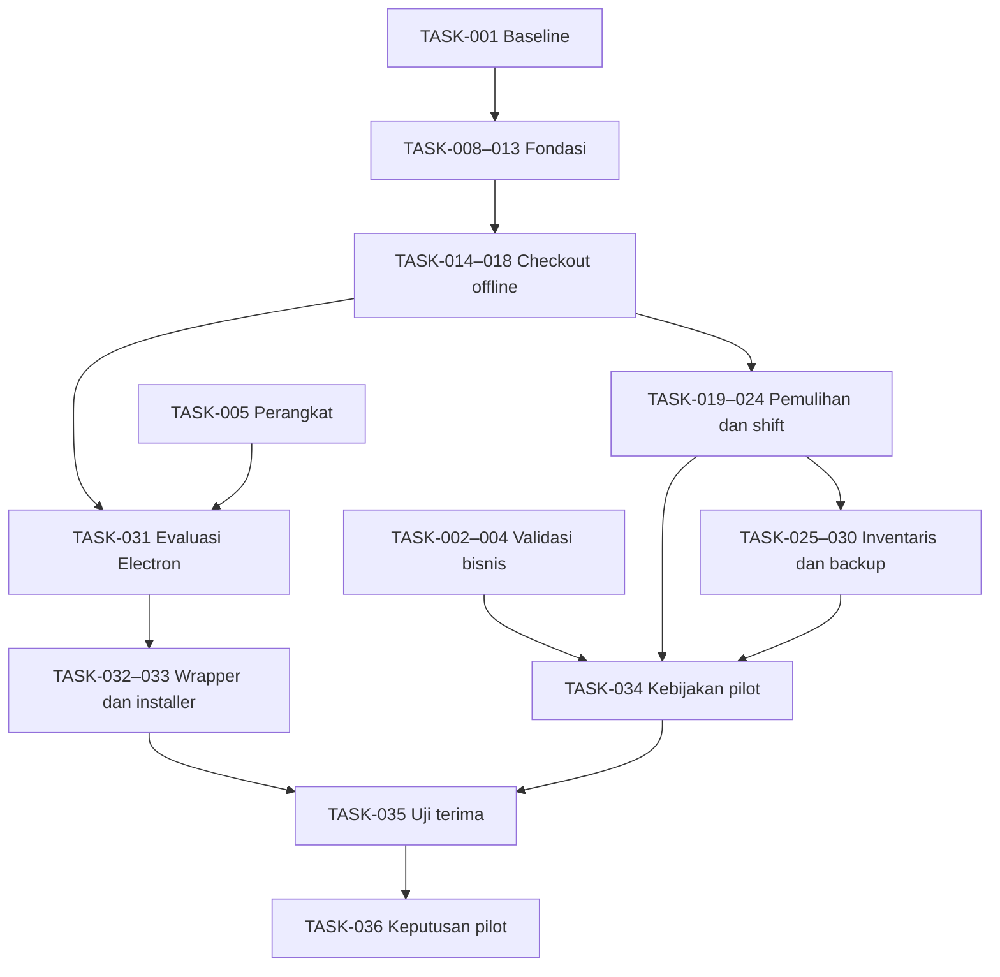

# Rencana Kerja MVP — Sistem Kasir dan Inventaris Minimarket Kampus

## 1. Document Control

| Atribut | Isi |
|---|---|
| Lokasi | `docs/product/TASKS.md` |
| Versi | 0.2.1 |
| Status | DRAFT — rencana 14 hari, belum bukti selesai |
| Koordinator | David |
| Sumber utama | CONTEXT.md v0.1.0 (salinan CONTEXT(1).md), PRD.md v0.3.1, DECISIONS.md v0.2.3, AGENTS.md (salinan AGENTS (1).md) |
| Dokumen teknis | ARCHITECTURE.md, DATABASE.md, dan AUTHORIZATION.md tersedia sebagai draft. Bukti review final belum tersedia. Gunakan sebagai bahan TASK-001, dengan keputusan dan implementasi tetap mengikuti status register. |

> **Pembaruan 11 November 2026:** target pengguna adalah **penggantian sistem lama dalam 14 hari**, bukan sekadar pilot. Strategi 33 MD selesai sebelum coding **tidak berlaku untuk tenggat ini**; dokumen kritis, coding, migrasi dan pengujian berjalan paralel. `DEC-016` memilih QRIS manual; `DEC-017` mengusulkan menunda member/retur/refund otomatis. Semua 41 tugas menjadi **satu backlog aktif** dengan ID tetap; estimasi adalah perkiraan awal, **bukan jadwal 7 minggu**. Jadwal prioritas untuk tenggat ini ada pada §8. Semua status awal berarti belum dikerjakan, bukan progres aktual.

## 2. Project Goals and Planning Assumptions

Bangun irisan penjualan lokal di satu PC dengan dua role dan SQLite. Buktikan scan/cari → checkout → saldo stok sebelum menambah alur penuh. Dua shift berurutan, pemulihan, backup, dan perangkat menjadi bagian uji P0. Target distribusi Windows diterima. Electron, stack awal dan rincian skema perlu review.

Estimasi memakai jam fokus pemilik, termasuk belajar dan verifikasi lokal. Sediakan tambahan 25–35% untuk review, debugging, dan integrasi lintas pemilik. Hari pada §8 adalah target urutan kerja, bukan janji kapasitas; bila dependensi atau kapasitas tidak tersedia, jadwal dan kelayakan cutover harus ditinjau ulang. Tunai, unit utuh dan blokir stok negatif dipakai sebagai fixture pengembangan, dengan kebijakan pilot menunggu validasi.

## 3. Team Roles and Responsibilities

| Anggota | Fokus | Review lintas pemilik |
| --- | --- | --- |
| David | Koordinasi, analisis, desain DB, review integrasi | Skema, aturan bisnis, scope dan gerbang pilot |
| Syafroni | UI kasir/admin, status perangkat dan pemulihan | Kontrak UI/backend dan alur pengguna |
| Rahmat | API lokal, akses backend, SQLite dan transaksi | Kontrak data, konkurensi dan packaging |
| Naazmi | QA, dokumentasi, perangkat dan integrasi | Bukti AC, uji perangkat, backup/restore dan regresi |

## 4. MVP Scope and Milestones

**Scope terkini:** lihat `SCOPE.md` v0.1.1. Tunai + QRIS manual adalah jalur pembayaran P0; member/kredit, refund/retur otomatis, QRIS API dan cloud ditunda. Dashboard minimal dan koreksi stok terotorisasi ditambahkan. Tidak boleh cutover tanpa bukti migrasi dan uji pada PC asli.

| Milestone | Hasil yang bisa diperiksa | Gerbang |
|---|---|---|
| M1 · Fondasi | Login offline, kontrol akses, master dan keranjang | TASK-013 |
| M2 · Penjualan lokal | Scan sampai checkout dan saldo, dengan rollback dan retry | TASK-018 |
| M3 · Operasi harian | Restart, struk, dua shift, penerimaan, laporan dan restore | TASK-024 dan TASK-029 |
| M4 · Kandidat Windows | Evaluasi perangkat dan wrapper, installer dan upgrade uji | TASK-031–033 |
| M5 · Pilot | SOP disahkan, semua AC P0 diuji, pengelola review | TASK-034–036 |

Cloud, kiosk, QRIS otomatis, retur/refund otomatis, member kredit, akses admin lintas perangkat dan laporan supplier/departemen lanjutan berada di luar rilis 14 hari kecuali pengelola membuktikan wajib. QRIS **manual** termasuk P0 (TASK-037).

## 5. Work Breakdown Structure

| Paket kerja | Tugas utama |
|---|---|
| Baseline, fixture, akses, katalog | TASK-001, TASK-006–013 |
| Shift, penjualan, stok, retry, struk | TASK-014–024 |
| Penerimaan, laporan dan pemulihan data | TASK-025–030 |
| Validasi bisnis, perangkat dan pilot | TASK-002–005, TASK-031–036, TASK-038, TASK-041 |
| QRIS manual, koreksi stok, dashboard minimum | TASK-037, TASK-039, TASK-040 |

## 6. Task Backlog

Prioritas P0 berarti mendukung kebutuhan P0 atau menjadi prasyarat uji terima. **Mulai** berarti tidak ada dependensi pekerjaan. **Antre** berarti menunggu tugas pendahulu. **Blocked** berarti ada keputusan atau kondisi eksternal yang belum tersedia. Reviewer pertama tercantum di tabel. Perubahan lintas skema, API, uang, stok, atau izin tetap melibatkan pemilik lain yang terdampak sesuai AGENTS.md.

| ID | Tugas | Jenis | Owner / reviewer | Prioritas | Estimasi | Dependensi | Status awal | Referensi POS/AC dan DEC | Acceptance criteria |
| --- | --- | --- | --- | --- | --- | --- | --- | --- | --- |
| TASK-001 | Tetapkan kontrak irisan pertama | Dokumentasi | David / Rahmat | P0 | 3 jam | — | Mulai | — · DEC-004, DEC-007, DEC-010, DEC-014 | Review draft skema, transport, izin dan status hasil commit; catat baseline reversibel serta batas fixture. |
| TASK-002 | Konfirmasi pembayaran dan setoran | Validasi | David / Naazmi | P0 | 3 jam | — | Mulai | POS-03.04/AC-03.04, POS-06.01/AC-06.01 · DEC-016 | Pengelola memberi daftar metode, arti debit/kredit, modal/setoran, contoh selisih dan prosedur saat hasil bayar belum jelas; jawaban kosong tercatat. |
| TASK-003 | Konfirmasi aturan stok dan data awal | Validasi | David / Naazmi | P0 | 3 jam | — | Mulai | POS-03.06/AC-03.06, POS-07.01/AC-07.01, POS-08.01/AC-08.01, POS-08.02/AC-08.02 · DEC-018, DEC-021 | Catat stok kurang, penerimaan, ekspor, saldo awal, zona laporan dan kebutuhan koreksi; dapatkan contoh data yang disetujui atau daftar pertanyaan tersisa. |
| TASK-004 | Konfirmasi akses dan serah terima | Validasi | Naazmi / David | P0 | 3 jam | — | Mulai | POS-01.03/AC-01.03, POS-05.01/AC-05.01, POS-05.02/AC-05.02, POS-06.02/AC-06.02 · DEC-012, DEC-019 | Catat siapa mengelola barang, pemilik shift, pengambilalihan, akses admin saat shift aktif, dan apakah PC khusus kasir. |
| TASK-005 | Inventarisasi perangkat kasir | QA | Naazmi / Rahmat | P0 | 4 jam | — | Mulai | POS-03.01/AC-03.01, POS-04.03/AC-04.03, POS-10.01/AC-10.01 · DEC-005, DEC-011 | Catat versi Windows, RAM/disk, model scanner/printer dan driver; uji scan angka nol awal, fokus input, dan cetak contoh; catat perangkat yang belum bisa diakses. |
| TASK-006 | Siapkan fixture dan bukti uji | QA | Naazmi / David | P0 | 4 jam | — | Mulai | POS-03.05/AC-03.05, POS-04.01/AC-04.01, POS-04.02/AC-04.02, POS-05.01/AC-05.01, POS-06.02/AC-06.02, POS-09.01/AC-09.01, POS-09.02/AC-09.02 · DEC-006, DEC-007, DEC-015 | Siapkan akun sintetis, dua shift, barang, tunai uji, stok kurang dan checklist interupsi. Tetapkan cara mengambil bukti SQLite tanpa data produksi. |
| TASK-007 | Buat kerangka layar lokal | Coding | Syafroni / Rahmat | P0 | 4 jam | TASK-001 | Antre | POS-01.01/AC-01.01, POS-03.01/AC-03.01, POS-03.07/AC-03.07 · DEC-009, DEC-010 | Login, katalog kasir dan navigasi role memakai fixture; aset dapat dimuat tanpa jaringan. |
| TASK-008 | Siapkan SQLite dan migrasi inti | Coding | Rahmat / David | P0 | 6 jam | TASK-001 | Antre | POS-03.05/AC-03.05, POS-07.02/AC-07.02, POS-10.02/AC-10.02 · DEC-004, DEC-007 | DB development terpisah; migrasi bisa dijalankan pada DB kosong dan salinan versi uji. FK aktif dan kegagalan migrasi tidak meninggalkan skema parsial. |
| TASK-009 | Implementasikan akses dan akun lokal | Coding | Rahmat / David | P0 | 7 jam | TASK-008 | Antre | POS-01.01/AC-01.01, POS-01.02/AC-01.02, POS-01.03/AC-01.03, POS-01.04/AC-01.04 · DEC-001, DEC-003, DEC-014 | Login offline, hash, sesi dan gate per operasi; nonaktifkan akun beserta aksesnya, audit perubahan, dan tolak panggilan langsung lintas role. |
| TASK-010 | Implementasikan master produk dan lookup | Coding | Rahmat / David | P0 | 6 jam | TASK-009 | Antre | POS-02.01/AC-02.01, POS-02.02/AC-02.02, POS-02.03/AC-02.03, POS-03.01/AC-03.01 · DEC-009, DEC-014 | Kelola kategori, supplier, produk, barcode, harga dan audit; barcode ganda ditolak dan lookup hanya memberi produk aktif. |
| TASK-011 | Hubungkan layar login dan akun | Coding | Syafroni / Naazmi | P0 | 6 jam | TASK-007, TASK-001 | Antre | POS-01.01/AC-01.01, POS-01.02/AC-01.02, POS-01.03/AC-01.03, POS-01.04/AC-01.04 · DEC-001, DEC-014 | Navigasi dari role backend; akses terlarang jelas; admin dapat menambah dan menonaktifkan kasir lewat kontrak lokal. |
| TASK-012 | Buat katalog admin dan keranjang | Coding | Syafroni / Rahmat | P0 | 6 jam | TASK-007, TASK-001 | Antre | POS-02.01/AC-02.01, POS-02.02/AC-02.02, POS-02.03/AC-02.03, POS-03.01/AC-03.01, POS-03.07/AC-03.07 · DEC-009, DEC-010 | Admin mengelola data; kasir scan/cari manual dan batal draft tanpa commit; gunakan mock kontrak saat API belum siap. |
| TASK-013 | Uji akses dan katalog terintegrasi | QA | Naazmi / David | P0 | 6 jam | TASK-009, TASK-010, TASK-011, TASK-012, TASK-006 | Antre | POS-01.01/AC-01.01, POS-01.02/AC-01.02, POS-01.03/AC-01.03, POS-01.04/AC-01.04, POS-02.01/AC-02.01, POS-02.02/AC-02.02, POS-02.03/AC-02.03, POS-03.01/AC-03.01, POS-03.07/AC-03.07 · DEC-001, DEC-014 | Uji API langsung lintas role, akun nonaktif, data master invalid, barcode tak dikenal/ganda, harga dan batal draft. Simpan bukti. |
| TASK-014 | Persistensikan pembukaan shift | Coding | Rahmat / David | P0 | 4 jam | TASK-009, TASK-008 | Antre | POS-05.01/AC-05.01, POS-05.02/AC-05.02 · DEC-002, DEC-006, DEC-012 | Pembukaan eksplisit; percobaan paralel menghasilkan satu shift aktif. Logout dan restart mempertahankan ID dan pemilik. |
| TASK-015 | Siapkan ledger dan saldo awal uji | Coding | Rahmat / David | P0 | 5 jam | TASK-008, TASK-010 | Antre | POS-03.06/AC-03.06, POS-07.02/AC-07.02, POS-08.02/AC-08.02 · DEC-004, DEC-007, DEC-018 | Saldo dapat ditelusuri ke mutasi, produk tanpa mutasi bersaldo nol, fixture pembukaan sintetis dapat direkonsiliasi. |
| TASK-016 | Simpan checkout atomik dengan retry | Coding | Rahmat / David | P0 | 7 jam | TASK-010, TASK-014, TASK-015 | Antre | POS-03.02/AC-03.02, POS-03.03/AC-03.03, POS-03.04/AC-03.04, POS-03.05/AC-03.05, POS-03.06/AC-03.06, POS-03.08/AC-03.08, POS-04.01/AC-04.01 · DEC-007, DEC-013, DEC-016, DEC-018 | Validasi pemilik, harga, tunai uji dan stok saat commit; rollback utuh, satu hasil per kunci, hash berbeda ditolak, histori final terlindungi. |
| TASK-017 | Hubungkan shift dan checkout kasir | Coding | Syafroni / Rahmat | P0 | 7 jam | TASK-012, TASK-014 | Antre | POS-03.02/AC-03.02, POS-03.03/AC-03.03, POS-03.04/AC-03.04, POS-03.05/AC-03.05, POS-03.06/AC-03.06, POS-05.01/AC-05.01, POS-05.02/AC-05.02 · DEC-006, DEC-012, DEC-016, DEC-018 | UI menampilkan shift sendiri, konfirmasi ulang harga, stok kurang dan hasil commit. Mock dahulu bila endpoint checkout belum tersedia. |
| TASK-018 | Buktikan irisan pertama offline | QA | Naazmi / Rahmat | P0 | 6 jam | TASK-016, TASK-017, TASK-006 | Antre | POS-03.02/AC-03.02, POS-03.03/AC-03.03, POS-03.04/AC-03.04, POS-03.05/AC-03.05, POS-03.06/AC-03.06, POS-03.08/AC-03.08, POS-04.01/AC-04.01, POS-05.01/AC-05.01, POS-05.02/AC-05.02 · DEC-006, DEC-007, DEC-013 | Jalankan scan sampai checkout dan baca saldo dari jaringan terputus; uji gagal commit, harga berubah, stok kurang dan retry paralel. |
| TASK-019 | Pulihkan hasil checkout | Coding | Rahmat / David | P0 | 5 jam | TASK-016 | Antre | POS-04.01/AC-04.01, POS-04.02/AC-04.02 · DEC-007, DEC-013 | Persistensikan identitas dan status yang diperlukan; lookup milik kasir setelah restart atau shift ditutup; kasus belum diketahui tidak memicu bayar ulang. |
| TASK-020 | Tampilkan pemulihan checkout | Coding | Syafroni / Naazmi | P0 | 5 jam | TASK-017, TASK-019 | Antre | POS-04.01/AC-04.01, POS-04.02/AC-04.02 · DEC-013, DEC-016 | Kasir melihat tersimpan, belum tersimpan terkonfirmasi, atau belum diketahui; tampilkan arahan pemeriksaan pembayaran fisik. |
| TASK-021 | Cetak dari transaksi tersimpan | Integrasi | Syafroni / Naazmi | P0 | 5 jam | TASK-016, TASK-005 | Antre | POS-04.03/AC-04.03 · DEC-005, DEC-013 | Adapter lokal memakai struk dengan nomor dan harga historis; kegagalan cetak dapat dicoba ulang tanpa mutasi. |
| TASK-022 | Simpan penutupan dan ringkasan shift | Coding | Rahmat / David | P0 | 5 jam | TASK-016 | Antre | POS-06.01/AC-06.01, POS-06.02/AC-06.02, POS-06.03/AC-06.03 · DEC-006, DEC-012, DEC-016 | Dengan fixture, penutupan eksplisit mencatat ringkasan; checkout yang commit lebih dulu masuk rekap. Gagal tutup mempertahankan shift, retry mengembalikan hasil asli. |
| TASK-023 | Buat layar penutupan shift | Coding | Syafroni / Naazmi | P0 | 4 jam | TASK-017, TASK-022 | Antre | POS-06.01/AC-06.01, POS-06.02/AC-06.02, POS-06.03/AC-06.03 · DEC-012, DEC-016 | Pratinjau dan konfirmasi, status gagal dan retry memakai fixture; shift kedua dapat dibuka setelah tutup berhasil. |
| TASK-024 | Uji restart, printer, dan dua shift | QA | Naazmi / Rahmat | P0 | 7 jam | TASK-018, TASK-019, TASK-020, TASK-021, TASK-022, TASK-023 | Antre | POS-04.01/AC-04.01, POS-04.02/AC-04.02, POS-04.03/AC-04.03, POS-05.01/AC-05.01, POS-05.02/AC-05.02, POS-06.01/AC-06.01, POS-06.02/AC-06.02, POS-06.03/AC-06.03 · DEC-006, DEC-007, DEC-012, DEC-013 | Interupsi sebelum/sesudah commit, respons hilang, cetak ulang dan checkout versus tutup; periksa database, rekap dan status UI. |
| TASK-025 | Simpan penerimaan dan mutasinya | Coding | Rahmat / David | P0 | 5 jam | TASK-015, TASK-010 | Antre | POS-07.01/AC-07.01, POS-07.02/AC-07.02 · DEC-004, DEC-007, DEC-018 | Penerimaan aktual mengikat supplier dan petugas; gagal simpan rollback, retry identik satu hasil. |
| TASK-026 | Sediakan query laporan dasar | Coding | Rahmat / David | P0 | 4 jam | TASK-022, TASK-025 | Antre | POS-08.01/AC-08.01, POS-08.02/AC-08.02 · DEC-004, DEC-018 | Filter tanggal/zona fixture dan shift, saldo dan riwayat dengan sumber; hasil cocok dengan data sintetis. |
| TASK-027 | Buat layar penerimaan dan laporan | Coding | Syafroni / Naazmi | P0 | 6 jam | TASK-012, TASK-025, TASK-026 | Antre | POS-07.01/AC-07.01, POS-07.02/AC-07.02, POS-08.01/AC-08.01, POS-08.02/AC-08.02 · DEC-009, DEC-018 | Draft dapat dibuang, penerimaan menunjukkan status hasil dan rekap dapat difilter; saldo dan mutasi ditampilkan. |
| TASK-028 | Buat cadangan dan validasi restore lokal | Integrasi | Rahmat / Naazmi | P0 | 5 jam | TASK-008 | Antre | POS-09.01/AC-09.01, POS-09.02/AC-09.02 · DEC-004, DEC-015 | Snapshot konsisten dan hasil terlihat; restore ke lingkungan terpisah, cek integritas dan tolak cadangan rusak tanpa menimpa DB aktif. |
| TASK-029 | Uji penerimaan, laporan, dan cadangan | QA | Naazmi / David | P0 | 6 jam | TASK-025, TASK-026, TASK-027, TASK-028 | Antre | POS-07.01/AC-07.01, POS-07.02/AC-07.02, POS-08.01/AC-08.01, POS-08.02/AC-08.02, POS-09.01/AC-09.01, POS-09.02/AC-09.02 · DEC-015, DEC-018 | Buktikan penerimaan satu kali, rekonsiliasi saldo/rekap serta backup valid, tujuan gagal tulis dan restore rusak. |
| TASK-030 | Review runbook pemulihan dan cutover | Dokumentasi | David / Naazmi | P0 | 4 jam | TASK-028, TASK-003 | Antre | POS-09.01/AC-09.01, POS-09.02/AC-09.02, POS-10.02/AC-10.02 · DEC-015, DEC-021 | Catat operator, retensi, media, validasi hasil, rekonsiliasi data awal, rollback dan pertanyaan untuk pengelola. |
| TASK-031 | Evaluasi Electron di Windows | QA | Naazmi / Rahmat | P0 | 6 jam | TASK-005, TASK-018, TASK-021 | Antre | POS-03.01/AC-03.01, POS-04.03/AC-04.03, POS-10.01/AC-10.01 · DEC-005, DEC-010, DEC-011 | Uji paket kandidat Electron pada PC tujuan untuk startup, RAM/disk, scan, cetak dan checkout offline. Catat temuan dan pembanding bila perlu; belum memilih wrapper. |
| TASK-032 | Review dan pilih baseline wrapper | Integrasi | David / Rahmat | P0 | 3 jam | TASK-031 | Antre | POS-10.01/AC-10.01, POS-10.02/AC-10.02 · DEC-005, DEC-011 | Tim mencatat pilihan berdasar hasil uji, kompatibilitas driver, biaya dan trade-off. Jika tidak cukup bukti, pertahankan status usulan. |
| TASK-033 | Paketkan installer dan pembaruan | Integrasi | Rahmat / Naazmi | P0 | 7 jam | TASK-032, TASK-028, TASK-030 | Blocked | POS-10.01/AC-10.01, POS-10.02/AC-10.02 · DEC-005, DEC-011, DEC-015, DEC-021 | Setelah wrapper dipilih, installer berjalan offline, upgrade menjaga DB dan konfigurasi, jalur rollback diuji pada salinan. |
| TASK-034 | Kunci fixture dan kebijakan pilot | Integrasi | David / Naazmi | P0 | 5 jam | TASK-002, TASK-003, TASK-004, TASK-024, TASK-029, TASK-030 | Blocked | POS-03.04/AC-03.04, POS-03.06/AC-03.06, POS-06.01/AC-06.01, POS-07.01/AC-07.01, POS-08.01/AC-08.01, POS-09.01/AC-09.01, POS-09.02/AC-09.02 · DEC-016, DEC-017, DEC-018, DEC-019, DEC-021 | Hanya setelah keputusan lapangan tersedia, hubungkan konfigurasi dan skenario uji ke SOP disahkan; catat kebutuhan baru untuk review scope. |
| TASK-035 | Uji terima pada PC tujuan | QA | Naazmi / David | P0 | 8 jam | TASK-024, TASK-029, TASK-033, TASK-034, TASK-037, TASK-038, TASK-039, TASK-040 | Blocked | POS-01.01/AC-01.01, POS-03.01/AC-03.01, POS-03.05/AC-03.05, POS-04.01/AC-04.01, POS-04.02/AC-04.02, POS-04.03/AC-04.03, POS-05.01/AC-05.01, POS-05.02/AC-05.02, POS-06.01/AC-06.01, POS-07.02/AC-07.02, POS-09.01/AC-09.01, POS-09.02/AC-09.02, POS-10.01/AC-10.01, POS-10.02/AC-10.02 · DEC-003, DEC-005, DEC-007, DEC-015, DEC-016, DEC-021 | Jalankan semua AC P0 lewat alur normal dan negatif, offline, dua shift, restore dan upgrade; kasir/pengelola review bukti dan daftar bug. |
| TASK-036 | Putuskan kesiapan pilot | Validasi | David / Naazmi | P0 | 3 jam | TASK-035, TASK-041 | Blocked | — · DEC-021 | Catat hasil uji, bug terbuka, persetujuan pengelola, jadwal yang benar-benar disepakati dan rencana kembali. Tunda jika gerbang belum lulus. |

### 6.1 Tugas P0 lanjutan — bagian dari backlog aktif, bukan pekerjaan opsional

| ID | Tugas | Owner / reviewer | Prioritas | Dependensi | Bukti selesai |
|---|---|---|---|---|---|
| TASK-037 | QRIS manual: status verifikasi, catatan kasir/waktu, UI konfirmasi, laporan terpisah | Rahmat + Syafroni / Naazmi | P0 | TASK-016, TASK-017, TASK-002 | AC-03.09, AC-X-01 PASS; tidak ada auto-confirm dan tidak menyimpan kredensial bank |
| TASK-038 | Migrasi data lama: cek ekspor, mapping, impor/idempotency, rekonsiliasi SKU/harga/barcode/stok | David + Rahmat / Naazmi | P0 | TASK-003, TASK-008, TASK-010 | AC-10.03, AC-X-05 PASS; daftar selisih nol atau ditangani resmi |
| TASK-039 | Koreksi stok admin dengan ledger dan audit | Rahmat + Syafroni / David | P0 | TASK-015, TASK-009 | AC-07.03 PASS; alasan wajib, kasir ditolak, saldo tidak negatif |
| TASK-040 | Dashboard minimum admin (omzet, transaksi, metode, shift, stok menipis/habis) | Syafroni + Rahmat / Naazmi | P0 | TASK-026, TASK-039 | AC-08.03 PASS; angka dapat direkonsiliasi |
| TASK-041 | Uji paralel, rencana rollback, berita acara GO/NO-GO | Naazmi + David / pengelola | P0 | TASK-024, TASK-029, TASK-033, TASK-034, TASK-037, TASK-038, TASK-039, TASK-040 | AC-GO-01 dan AC-X-02–04 PASS; tanda tangan persetujuan operasional |

## 7. Task Dependencies

**Integrasi perubahan:** TASK-037, TASK-038, TASK-039, dan TASK-040 wajib selesai serta diuji sebelum TASK-035 boleh dinyatakan selesai; TASK-041 mengumpulkan hasil uji paralel dan rekomendasi GO/NO-GO. TASK-036 hanya ditutup setelah TASK-035 **dan** TASK-041 menghasilkan bukti dan persetujuan.

Tabel backlog memegang dependensi langsung. Jalur di bawah menyorot titik serah terima dan gerbang. Ketika UI memakai mock, kriteria yang perlu backend dibuktikan pada tugas integrasi atau QA terkait.

Jalur penulis SQLite dan checkout harus stabil sebelum penutupan shift dan pemulihan ikut menyentuhnya. Rahmat dan David review perubahan jalur tulis secara berurutan. Jalur perangkat dan validasi bisnis dapat dimulai lebih awal. Jika perangkat tujuan belum tersedia, Naazmi dapat berlatih dengan perangkat uji, sementara bukti kompatibilitas pilot tetap tertunda.

## 8. Jadwal 14 hari dan pembagian tanggung jawab

**Periode sasaran:** 11–25 November 2026. Jadwal sangat agresif untuk tim pemula. Perangkat, ekspor data, keputusan SOP, dan waktu review dapat membuat target gagal. Ini rencana, bukan laporan pekerjaan yang sudah selesai. Kerjakan paralel lintas pemilik tetapi perubahan jalur tulis SQLite harus direview berurutan.

| Hari | David — koordinasi/data | Rahmat — backend/integrasi | Syafroni — frontend | Naazmi — QA/perangkat | Gate harian |
|---|---|---|---|---|---|
| 1 | Kunci SCOPE dan pertanyaan VAL-01–08; minta data lama | Review DB, kontrak checkout dan risiko pembayaran | Wireframe login, kasir, admin, shift | Inventaris PC/scanner/printer, buat fixture | Format ekspor, SOP dan akses PC diketahui atau ditandai blocker |
| 2–3 | Mapping data dan review arsitektur/DB/auth | Spike SQLite, API lokal, packaging Electron; migrasi inti | Kerangka UI offline dan mock kontrak | Uji scanner/printer/installer awal | Demo jalur perangkat; stack dipilih berdasarkan bukti |
| 4–5 | Review akun, barang, stok awal dan aturan uang | Auth, produk/barcode, shift, ledger | Login, master, keranjang, buka shift | Uji role, barcode, stok dan offline | Scan/cari sampai keranjang dan shift nyata |
| 6–7 | Review aturan checkout dan data migrasi | Checkout tunai atomik, idempotency dan status pemulihan | UI checkout, status gagal, struk awal | Uji crash/retry/rollback dan stok | Penjualan tunai tidak ganda dan stok konsisten |
| 8–9 | Konfirmasi SOP QRIS dan setoran | QRIS manual, tutup shift, penerimaan dan koreksi stok | UI QRIS, shift, admin stok | Uji QRIS pending, dua shift, selisih dan audit | QRIS manual dan shift sesuai SOP |
| 10 | Cocokkan impor awal, siapkan rollback | Query laporan, backup SQLite, integrasi installer | Dashboard minimum dan perbaikan UI | Uji restore pada salinan, cetak ulang | Laporan, restore dan paket dasar lulus |
| 11–12 | Rekonsiliasi data dan jadwalkan uji dengan kasir | Perbaikan bug integrasi dan packaging | Perbaikan bug kasir/admin | Uji paralel pada PC tujuan, migrasi, offline dan listrik mati | Tidak ada selisih data awal/bug kritis |
| 13 | Review semua blocker dan persetujuan SOP | Perbaiki bug kritis terakhir | Perbaiki bug kritis terakhir | UAT dengan kasir/pengelola, latihan rollback | Daftar bukti lengkap atau NO-GO |
| 14 | Putuskan GO/NO-GO bersama pengelola | Siaga teknis dan backup final | Siaga UI dan operasional | Verifikasi final dan pantau cutover bila GO | Persetujuan tertulis; bila gagal, gunakan sistem lama/opsi resmi |

**Aturan kapasitas:** tiap orang maksimal satu pekerjaan berisiko tinggi pada satu waktu. Jangan menganggap estimasi jam pada backlog lama sebagai janji muat dalam 14 hari. Jika data lama, QRIS merchant, printer atau SOP belum tersedia pada hari 3, David wajib menaikkan status risiko ke pengelola dan menyiapkan opsi perpanjangan langganan.

## 9. Integration and Testing Tasks

| Bukti | Tugas | Pemeriksaan utama |
|---|---|---|
| Akses dan master | TASK-013 | Login offline, panggilan API lintas role, barcode ganda dan audit harga. |
| SQLite dan checkout | TASK-018 | Interupsi sebelum commit, rollback penjualan/pembayaran/mutasi, payload konflik, retry bersamaan. |
| Pemulihan dan shift | TASK-024 | Restart sebelum/sesudah commit, printer mati, cetak ulang, logout dan dua shift, persaingan tutup versus checkout. |
| Inventaris dan cadangan | TASK-029 | Retry penerimaan, laporan tanggal/shift, ledger dan saldo, backup gagal tulis, restore valid dan rusak. |
| Perangkat dan paket | TASK-005, TASK-031, TASK-033, TASK-035 | Scanner, printer, RAM/disk, startup offline, pembaruan dan pemulihan di PC Windows tujuan. |

Naazmi menyimpan langkah uji, versi/lingkungan, fixture, hasil aktual, dan ID bug. Uji interupsi proses membuktikan skenario simulasi. Bukti perangkat dan kondisi operasional pilot dicatat terpisah. Bukti final menghubungkan status UI dengan data SQLite saat itu.

## 10. Business Validation Tasks

| Tugas | Pihak dan keluaran | Dampak jika belum dijawab |
|---|---|---|
| TASK-002 | David dan pengelola mengesahkan metode bayar, setoran, modal, selisih dan pemeriksaan bukti fisik. | TASK-034/035 tertahan. Checkout dan shift tetap bisa diuji dengan fixture. |
| TASK-003 | David dan pengelola mengesahkan stok kurang, penerimaan, data awal, zona laporan dan kebutuhan koreksi. | Rekonsiliasi dan uji pilot tertahan. |
| TASK-004 | Naazmi, David dan pengelola mencatat akses admin serta prosedur serah terima. | Hak akses pilot dan penanganan shift tertahan. |
| TASK-034/036 | David mencatat keputusan pilot, pihak yang menyetujui, dan tanggal bila ada bukti. | Pilot menunggu hasil uji, keputusan operasional, dan kesiapan data awal. |

Validasi yang menghasilkan jawaban sebagian dapat ditutup sebagai kegiatan pengumpulan bukti dengan pertanyaan tersisa tercatat. TASK-034 tetap blocked hingga kebijakan yang diperlukan untuk pilot disahkan.

## 11. Risks and Blockers

| Risiko / blocker | Tugas terdampak | Respons |
|---|---|---|
| SOP bayar, setoran, stok dan akses belum lengkap | TASK-034–036 | Lanjutkan fixture, minta contoh sah, pisahkan temuan scope dari implementasi. |
| PC tujuan, scanner atau printer belum bisa dipinjam | TASK-005, TASK-031–033, TASK-035 | Catat yang bisa disimulasikan. Jadwalkan uji fisik sebelum memilih paket. |
| Pilihan wrapper belum direview | TASK-033 | Tunggu TASK-032. Evaluasi kandidat Electron pada TASK-031. |
| Satu pemilik backend menjadi jalur kritis | TASK-009/010, TASK-014–016, TASK-019/022, TASK-025/026/028 | Kerjakan perubahan tulis secara berurutan. David membantu review skema, Syafroni memakai kontrak fixture, Naazmi menyiapkan bukti. |
| Crash atau restore memicu transaksi ganda dan saldo keliru | TASK-018, TASK-024, TASK-029, TASK-035 | Uji commit, retry, rekonsiliasi pembayaran fisik dan cadangan terpisah. |
| Format ekspor, saldo awal dan waktu cutover belum pasti | TASK-030, TASK-034–036 | Konfirmasi dengan pengelola, uji migrasi pada salinan dan siapkan prosedur kembali. |

**Dapat dimulai:** TASK-001–006. Mulai satu tugas per pemilik. David mendahulukan TASK-001. Naazmi mengurutkan perangkat dan fixture sesuai akses. **Blocked:** TASK-033 menunggu pilihan wrapper, TASK-034 menunggu kebijakan pilot, TASK-035 menunggu paket/perangkat dan SOP, serta TASK-036 menunggu bukti uji dan keputusan pengelola. Jika akses perangkat belum tersedia, ubah TASK-031 menjadi Blocked. Catat alasan dan pemilik tindak lanjut.

## 12. Definition of Ready

- [ ] Outcome dapat diperiksa dan ID POS/AC/DEC terkait sudah ditulis, atau alasan ketiadaan ID dicatat.
- [ ] Pemilik, reviewer, estimasi, dan dependensi tersedia.
- [ ] Dependensi langsung lulus atau kontrak mock yang diperbolehkan dicatat.
- [ ] Fixture sintetis tersedia dan kebutuhan SOP/perangkat dipisahkan dari asumsi.
- [ ] Dampak pada skema, API, izin, uang atau stok telah direview sesuai AGENTS.md.

## 13. Definition of Done

- [ ] Acceptance criteria tugas dan AC terkait dibuktikan pada lingkungan yang disebutkan.
- [ ] Uji jalur normal dan kegagalan relevan dijalankan. Catat hasil aktual dan bug terbuka.
- [ ] Untuk coding, perubahan masuk melalui PR yang direview dengan fixture, perintah uji, dan hasil yang dapat diulang.
- [ ] Untuk validasi, sumber jawaban, pihak, tanggal bila diketahui, dan pertanyaan yang tersisa dicatat.
- [ ] Untuk integrasi perangkat/pilot, bukti mencantumkan perangkat, versi aplikasi dan kondisi offline.
- [ ] Status Done diberikan setelah bukti dan review tersedia. Kelulusan fixture pengembangan dipisahkan dari kelulusan pilot.

## 14. Progress Tracking Rules

Gunakan satu GitHub repo dan status Backlog → Ready → In Progress → Review → Done. Blocked menyertakan penyebab, pemilik tindak lanjut, dan syarat membuka kembali. Gunakan VS Code dan AI coding agent dengan konteks TASK, POS, AC dan DEC. Agent mengusulkan perubahan kecil, menunjukkan perintah uji yang benar-benar berjalan, dan tidak mengunci keputusan yang belum disahkan.

Evaluasi mingguan mencatat target selesai/tertunda, progres tiap pemilik, fitur yang sudah dijalankan, bug atau hambatan, keputusan/bantuan yang dibutuhkan dan target realistis berikutnya. Naikkan temuan scope ke David. Rekap beban fokus dan waktu review aktual agar estimasi dapat dikalibrasi.

## 15. Requirement Coverage Matrix

| Requirement | Acceptance | Tugas terkait |
| --- | --- | --- |
| POS-01.01 | AC-01.01 | TASK-007, TASK-009, TASK-011, TASK-013, TASK-035 |
| POS-01.02 | AC-01.02 | TASK-009, TASK-011, TASK-013 |
| POS-01.03 | AC-01.03 | TASK-004, TASK-009, TASK-011, TASK-013 |
| POS-01.04 | AC-01.04 | TASK-009, TASK-011, TASK-013 |
| POS-02.01 | AC-02.01 | TASK-010, TASK-012, TASK-013 |
| POS-02.02 | AC-02.02 | TASK-010, TASK-012, TASK-013 |
| POS-02.03 | AC-02.03 | TASK-010, TASK-012, TASK-013 |
| POS-03.01 | AC-03.01 | TASK-005, TASK-007, TASK-010, TASK-012, TASK-013, TASK-031, TASK-035 |
| POS-03.02 | AC-03.02 | TASK-016, TASK-017, TASK-018 |
| POS-03.03 | AC-03.03 | TASK-016, TASK-017, TASK-018 |
| POS-03.04 | AC-03.04 | TASK-002, TASK-016, TASK-017, TASK-018, TASK-034 |
| POS-03.05 | AC-03.05 | TASK-006, TASK-008, TASK-016, TASK-017, TASK-018, TASK-035 |
| POS-03.06 | AC-03.06 | TASK-003, TASK-015, TASK-016, TASK-017, TASK-018, TASK-034 |
| POS-03.07 | AC-03.07 | TASK-007, TASK-012, TASK-013 |
| POS-03.08 | AC-03.08 | TASK-016, TASK-018 |
| POS-04.01 | AC-04.01 | TASK-006, TASK-016, TASK-018, TASK-019, TASK-020, TASK-024, TASK-035 |
| POS-04.02 | AC-04.02 | TASK-006, TASK-019, TASK-020, TASK-024, TASK-035 |
| POS-04.03 | AC-04.03 | TASK-005, TASK-021, TASK-024, TASK-031, TASK-035 |
| POS-05.01 | AC-05.01 | TASK-004, TASK-006, TASK-014, TASK-017, TASK-018, TASK-024, TASK-035 |
| POS-05.02 | AC-05.02 | TASK-004, TASK-014, TASK-017, TASK-018, TASK-024, TASK-035 |
| POS-06.01 | AC-06.01 | TASK-002, TASK-022, TASK-023, TASK-024, TASK-034, TASK-035 |
| POS-06.02 | AC-06.02 | TASK-004, TASK-006, TASK-022, TASK-023, TASK-024 |
| POS-06.03 | AC-06.03 | TASK-022, TASK-023, TASK-024 |
| POS-07.01 | AC-07.01 | TASK-003, TASK-025, TASK-027, TASK-029, TASK-034 |
| POS-07.02 | AC-07.02 | TASK-008, TASK-015, TASK-025, TASK-027, TASK-029, TASK-035 |
| POS-08.01 | AC-08.01 | TASK-003, TASK-026, TASK-027, TASK-029, TASK-034 |
| POS-08.02 | AC-08.02 | TASK-003, TASK-015, TASK-026, TASK-027, TASK-029 |
| POS-09.01 | AC-09.01 | TASK-006, TASK-028, TASK-029, TASK-030, TASK-034, TASK-035 |
| POS-09.02 | AC-09.02 | TASK-006, TASK-028, TASK-029, TASK-030, TASK-034, TASK-035 |
| POS-10.01 | AC-10.01 | TASK-005, TASK-031, TASK-032, TASK-033, TASK-035 |
| POS-10.02 | AC-10.02 | TASK-008, TASK-030, TASK-032, TASK-033, TASK-035 |

TASK-035 menjalankan ulang seluruh AC P0 untuk kandidat pilot. Matriks menunjukkan tugas penghasil atau pemeriksa bukti per requirement. Pencantuman ID pada tugas validasi menunjukkan dependensi kebijakan, bukan kelulusan AC.

## 16. Open Planning Questions

- Berapa jam fokus per orang yang tersedia, dan siapa pengganti reviewer ketika jadwal bentrok?
- Kapan pengelola dan kasir dapat memvalidasi alur, serta kapan PC tujuan bisa dipakai untuk uji?
- Apakah hasil uji perangkat cukup untuk memilih wrapper? Driver, versi runtime, transport dan skema apa yang perlu review pada TASK-001/032?
- Apa format ekspor, zona operasional, saldo awal, kebijakan koreksi dan jadwal cutover yang disepakati?
- Apakah SOP pilot mewajibkan fitur PENDING? Jika ya, berapa dampak terhadap kapasitas dan cakupan rilis?

## 17. Kriteria penyelesaian paket product dan prioritas harian

- Dokumen `PRD`, `DECISIONS`, `SCOPE`, `USER_STORIES`, `ACCEPTANCE_CRITERIA`, dan `TASKS` sudah tersedia sebagai baseline **draft**. Status dokumen tidak sama dengan status pengembangan.
- Urutan pertama: TASK-002–005 dan TASK-038 (merchant, SOP, perangkat, data lama), sambil TASK-001/008 dan TASK-007 berjalan. Risiko terbesar adalah migrasi dan perangkat, bukan tampilan dashboard.
- QA mengisi bukti PASS/FAIL hanya setelah benar-benar menjalankan tes; jangan membuat hasil uji fiktif.
- Setiap hari David memeriksa 6 hal: progres, blocker, hasil yang berjalan, bug, keputusan, target esok hari. Semua kode di GitHub, review PR kecil.
- Bila syarat GO/NO-GO pada `SCOPE.md` atau `ACCEPTANCE_CRITERIA.md` gagal, hasil hari ke-14 adalah **NO-GO**, bukan sistem produksi.

## 18. Gerbang tugas final dan serah terima

| Gerbang | Tugas bukti | Hasil yang dapat diverifikasi |
|---|---|---|
| Pembayaran | TASK-002, TASK-016, TASK-037 | QRIS manual dan tunai mengikuti SOP, retry tidak ganda, bukti verifikasi merchant |
| Stok dan laporan | TASK-003, TASK-015, TASK-025–027, TASK-039, TASK-040 | Saldo dan mutasi cocok; koreksi ADMIN tercatat; angka laporan dapat ditelusuri |
| Migrasi dan perangkat | TASK-005, TASK-031–033, TASK-038 | Barcode, scanner/printer, installer dan data awal terbukti pada PC tujuan |
| Keandalan | TASK-019–024, TASK-028–030 | Restart, cetak ulang, dua shift, backup-restore teruji |
| Keputusan operasi | TASK-034–036, TASK-041 | Bukti UAT, uji paralel, persetujuan pengelola, rollback GO/NO-GO |

**Tidak ada tugas dianggap DONE karena kode berhasil digenerate.** Status hanya diperbarui setelah implementasi dan pengujian nyata. Kegiatan yang tidak muat dalam 14 hari dinaikkan sebagai risiko; jangan diam-diam menghapus P0.
